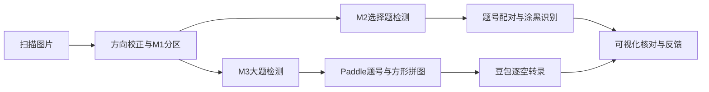

# 自动改卷

将扫描答题卡转换为可逐题核对的识别结果。目前支持选择题、填空及实验题，包含本地检测、手写转录和可视化验收。标准答案整理、评分及成绩导出尚待接入。

## 关于这个项目和我

这是我的第一个项目。我给自己的定位是“赛博监工”：代码都是 DeepSeek 和 GPT 帮我写的，这一点没什么好藏的。

我主要负责确定需求和取舍、设计识别与人工核对流程，以及拿实际试卷检查效果、找出问题，再推动修改。比如裁图怎么拼、题号怎么对应、涂改怎么处理、结果怎样展示才能方便人核对，这些都是我在迭代中参与决定的。

项目使用的数据集都经过人工审核。按2026-11-03的本地日志核对，M1／M2／M3当前已审核结果共 **85,234 个框**。我在闲鱼实际询到的标框报价是 **0.09 元／框**，按这个价格从零外包绘制，等价约 **7,671 元**。

| 已审核标注 | 框数 | 从零外包等价金额 |
|---|---:|---:|
| M1 版面分区 | 7,763 | 698.67 元 |
| M2 题号、选项 | 60,183 | 5,416.47 元 |
| M3 大题及题号 | 17,288 | 1,555.92 元 |
| **合计** | **85,234** | **7,671.06 元** |

模型、API和订阅累计投入，按我目前的回忆约 **805 元**。日志中可追溯或重建的框修改共 **11,459 次**：新增2,150次、调整6,696次、删除2,613次。为了统一比较，每次修改也按0.09元折算，约 **1,031.31 元**。据此记录三个“杠杆率”：

| 口径 | 计算方式 | 约数 |
|---|---|---:|
| 资金杠杆 | 从零外包等价金额 ÷ 模型及订阅投入 | **9.53 倍** |
| 标注修改杠杆 | 从零外包等价金额 ÷ 框修改折算金额 | **7.44 倍** |
| 合并折算 | 从零外包等价金额 ÷（模型及订阅投入＋框修改折算金额） | **4.18 倍** |

框数按每张图最终已审核结果计一次，不重复累计审核轮次；修改数包含多轮新增、调整和删除，旧日志部分通过前后框比较重建，不代表鼠标操作次数。上面的金额是询价与统一单价下的折算，805元投入也是约数；没有计入逐图人工审核、流程设计和验收工时，因此这些倍数不代表工时提效或实际收益。公开仓库只放汇总，不包含试卷或逐图审核日志。

所以，虽然代码是 AI 帮写的，我觉得自己在流程设计、数据质量和实际验收上的作用还是有的。这个仓库记录的，就是我和 AI 一起把想法做成能用的东西的过程。

## 功能

- 方向检查与校正，M1版面分区、M2选择题检测、M3大题检测。
- Paddle印刷题号识别、本地涂黑识别和题号配对。
- 大题裁图紧凑拼入约1500×1500方图，交给豆包Lite转录，默认4并发。
- 原卷缩放平移、选择答案叠加、逐空核对、实际拼图追溯。
- 人工反馈与草稿保存，Esc逐级返回，处理错误直接显示原因。
- 按图块保存API成功结果，同一批次中断后可续跑。

## 快速开始

1. 克隆 [my_first_project](https://github.com/KJNSAIUDHWI/my_first_project)，并按[使用说明](docs/使用说明.md)安装Python依赖。
2. 下载[weights目录](weights/)中的全部加密分卷，按[恢复说明](weights/说明.txt)解压到项目根目录。密码由项目持有人提供。
3. 在项目根目录的 `.env` 中配置 `ARK_API_KEY`，或设置同名环境变量。
4. 准备自己的扫描图片目录，在项目根目录运行：

```powershell
python -B pipeline/run.py --recognize --input "../papers" --out "../grading-results/run-001"
python -B tools/识别验收.py --dir "../grading-results/run-001" --port 8903
```

在浏览器打开 <http://127.0.0.1:8903/> 查看结果。图片已转正时，识别命令可加 `--working-images`，保留原像素。

仓库不包含试卷、训练数据或API密钥。克隆后的首次运行请使用 `--input` 指定图片目录；默认内部回归名单不随源码发布。

## 流程



当前转录规则会整体舍弃包含图片或示意图的小题，其他小题继续识别；正反面分别处理，不自动合并学生身份。详细规则见[架构说明](docs/架构说明.md)。

## 性能记录

2026-11-01的10页连续测试耗时 **36.8秒**，包含首次模型加载；14次API请求全部成功，估算费用 **约0.045元**。测试使用已转正物理答题卡、CPU FP32、豆包Lite非思考模式和4并发。各阶段耗时及200页记录见[性能测试](docs/性能测试.md)。

## 文档

| 文档 | 内容 |
|---|---|
| [使用说明](docs/使用说明.md) | 环境安装、权重恢复、密钥配置、识别与结果查看 |
| [架构说明](docs/架构说明.md) | 检测分工、转录规则、结果追溯及恢复机制 |
| [开发说明](docs/开发说明.md) | 代码入口、测试和模型管理 |
| [性能测试](docs/性能测试.md) | 实测耗时、token及费用记录 |
| [权重恢复](weights/说明.txt) | 分卷校验、解压与部署文件清单 |
