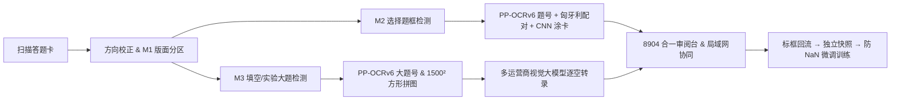

# 自动改卷

> **叠甲声明：** 本 README 由 AI 代笔（作者本人很懒，连项目介绍都外包给 AI 了，有 AI 味属于正常现象）。至于「这项目到底好不好用、能不能直接上生产」，先贴一张图表达我的严谨态度：

<p>
  
</p>

将扫描答题卡转换为可逐题核对的结构化识别结果，打通 **本地三级版面检测 → 印刷题号与涂卡识别 → 方形拼图手写转录 → 合一网页审阅与局域网协同 → 标框同步与本地微调训练** 的完整工程闭环。

- **开源协议与权重说明**：本仓库**代码采用 [MIT License](LICENSE) 开源**（纯代码不足 **2 MB**，秒级克隆）；自训纯推理权重包（**45.7 MB** 单文件，AES-256 含文件名加密）托管在 [GitHub Releases (`v2026.11.27`)](https://github.com/KJNSAIUDHWI/my_first_project/releases/tag/v2026.11.27)，**权重暂不公开开源，如需解压密码请联系维护者邮箱：`lkqxsdggyx@gmail.com`**。官方 `PP-OCRv6` 印刷题号 ONNX 模型由脚本直接从百度飞桨官方源拉取。
- **适用边界**：支持选择题、填空题与实验题识别核对；已在高中物理标准答题卡版式验证（切换新学科或新版式可在工作台「第 4 步：模型训练」中补充少量标注并微调）。标准答案自动判分与成绩导出留待后续扩展。
- **想看项目背景、AI 监工心得、成本杠杆账本与作者私货** → 请移步 [**作者的吹牛时间**](docs/作者的吹牛时间.md)。

---

## 一、CMD 命令行一键拉取与配置

环境要求：Windows x64 + Python 3.10+（推荐 Python 3.13）；本地推理与训练均**自动优先检测并使用本机 CUDA GPU**（无可用显卡时自动回退 CPU），可在工作台第 1 步一键本机测速选出最优并发与批大小。打开 **CMD** 依次执行：

```bat
:: 1. 克隆纯代码仓库
git clone https://github.com/KJNSAIUDHWI/my_first_project.git 自动改卷
cd 自动改卷

:: 2. 创建虚拟环境并安装依赖（国内可加 -i https://pypi.tuna.tsinghua.edu.cn/simple）
python -m venv .venv
.venv\Scripts\activate
pip install -r requirements.txt

:: 3. 拉取百度官方 PP-OCRv6 + 下载 GitHub Release 精简推理权重（45.7 MB）并按提示输密码解压
python scripts\download_weights.py

:: 4. 配置视觉大模型 API 密钥（复制 .env.example 为 .env，或在工作台网页右上角可视化填写）
copy .env.example .env
```

> **手动下载兜底**：如命令行访问 GitHub 较慢，可先点右上角 **Code → Download ZIP** 下载源码，再从 [Releases](https://github.com/KJNSAIUDHWI/my_first_project/releases/tag/v2026.11.27) 手动下载 `autograde_weights_v20261127.7z` 放进 `weights/` 目录，然后执行 `python scripts\download_weights.py`（或打开工作台点「输入密码解压加密权重」）。校验指纹见 [`weights/SHA256SUMS.txt`](weights/SHA256SUMS.txt) 与 [`weights/manifest.json`](weights/manifest.json)。

---

## 二、怎么用：桌面工作台（推荐）与纯命令行

### 方式 A：双击 `自动改卷工作台.exe`（四步完整闭环）

直接双击根目录 `自动改卷工作台.exe`，或命令行执行 `python apps\workbench\cli.py serve --open`（默认端口 `8888`），网页内置 4 步主轴与交互式 `? 新手引导`：

1. **运行环境**：自检 Python 依赖（支持真实导入校验与 `paddleocr`/`numpy`/`opencv` 版本冲突检查）、5 个自训模型、官方 `PP-OCRv6` 与 API 密钥；支持自动测速选源补包、输密码解压权重、右上角 **「⚙ 大模型 API」** 可视化配置（含带图视觉连通性测试、官网单价自动爬取与永久缓存），以及**推理设备切换与一键本机 Batch/并发性能压测（零 API 费用）**。
2. **导入试卷**：选择本地扫描照片文件夹与学科，非破坏性复制 + SHA256 去重重命名，并一键启动流式并发自动识别流水线（边检测边拼图边调用 API、实时增量合并结果）。
3. **审阅与协作**：实时展示**数据流向架构与实时费用面板**（纠偏 / M1 / M2 / M3 / 大模型拼图转录与实时估算 API 花费）及**中文错误/退出码诊断卡**，支持**一键补跑失败页与失败图块**（已成功缓存不重复扣费）；一键打开 **合一审阅台（`8904`）**（`8905` 选择题涂卡审核默认折叠在「更多可选工具」中）；填空/实验大题支持 **💬 悬停气泡** 与 **⇄ 左右双侧就近总览** 两种视图（左栏贴左、右栏贴右、零跨卷连线），学生未填写的空位明确标示「**未作答**」胶囊；同局域网下的其他电脑/平板打开主机网址即可免安装加入领卷，内置 **页级动态领卷 + 5 分钟租约锁 + 3 秒实时同步**。
4. **模型训练**：支持一键将当前批次已确认审阅页的 **M1 / M2 / M3** 标框同步入库（或直接切换 M1 / M2 / M3 打开 `8900` 批量标框；选择题涂卡 CNN 预训练泛化稳定，默认折叠为可选模块），选择模块与轮数启动**带防 NaN 数值保护的微调训练**，实时查看日志与 `8901` 训练监控；训练完成后需人工核对指标并手动点击 **「启用此权重」**（切换前自动备份上一版，随时一键回退）。

#### 合一审阅台（`8904`）常用快捷键

| 操作 | 快捷键 / 鼠标 |
|---|---|
| 放大 / 缩小原卷 | 滚轮缩放（**`F`** 一键适配） |
| 平移原卷画布 | 按住中键拖动 / 按住右键拖动 / `空格 + 左键拖动` |
| 暂隐所有叠层看原字 | 按住 **`Alt`** |
| 定位下一个低置信度框（`低置`） | **`L`**（弹窗标明来源模型/规则，确认无误点 `✓ 信任无误`） |
| 切换审阅 / 原地调框模式 | **`E`**（**左键长按拖**直接画新框、**左键单击**选中框缩放/移动、**右键单击**删框并同步消卡、**`Ctrl+Z`** 连原答案无损撤销） |
| 单框即时调用大模型 API 识别 | 调框模式下选中新画的「大题-框」或「姓名学号」框后按 **`R`**（或点浮条 `✨ API识别` / 右侧「一键识别本页全部待识别框」） |
| 保存当前页并跳下一张待审 | **`D`**（上一页 **`A`**） |

### 方式 B：纯命令行跑批

```bat
:: 完整识别（默认 --device auto 优先用 GPU；支持断点续跑，已成功缓存的 API 图块不重复扣费）
python -B engine\run.py --recognize --input "D:\papers" --out "D:\grading-results\run-001" --device auto --concurrency 4

:: 仅补跑失败/结构异常图块（已成功项绝不重复扣费）
python -B scripts\retry_failed_tiles.py --dir "D:\grading-results\run-001"

:: 本机推理 Batch 与并发压测（零 API 费用，自动推荐最优参数）
python -B scripts\benchmark_local.py --samples 4

:: 启动合一审阅与局域网协同服务
python -B apps\review\server.py --dir "D:\grading-results\run-001" --port 8904 --lan
```

---

## 三、项目设计架构与核心思路



项目围绕 **“低成本、可控精度、敢信任、能迭代”** 四个工程约束设计：

1. **三级级联检测 + 专模专用（把客观题完全留在本地）**
   不把整张试卷直接扔给视觉大模型（既贵又慢、还容易题号串行产生幻觉），而是拆成 **方向校正 → M1 版面分区（身份/选择/填空）→ M2 选择题（`PP-OCRv6` 读印刷题号 + 匈牙利算法一对一几何配对 + 几何连续性序列推算补全 `fix_no=True` + 本地轻量 CNN 读多选涂卡）→ M3 填空/实验大题裁切**。选择题 100% 在本地完成，零 API 费用。
2. **`1500×1500` 方形紧凑拼图 + 强约束 Prompt（把 VLM 费用压到几分钱）**
   大题裁图按独立图块 ID 紧凑拼入约 `1500×1500` 方图（等比不拉伸、同题号跨页绝不合并），默认 4 并发调用 OpenAI 兼容视觉大模型。Prompt 针对真实试卷踩坑做了显式约束：**划掉重写只取最终答案、印刷子题号 `(4)①→4.1`、含图片/示意图的小题整小题舍弃、LaTeX 反斜杠双写防 `\f` 变控制符**，配套 `strict_json` 拒绝重复键校验与按请求指纹缓存断点续跑（实测 10 页约 36.8 秒、约 0.045 元）。
3. **“不盲信 AI”的人机协同闭环**
   OCR 项目最怕错检混进最终结果。本系统将 YOLO 低置信度框、CNN 浅涂卡、序列推算题号（`no_source="sequence"`）、未配对框及 VLM 异常统一归因到具体题目框，在 `8904` 零遮挡网页里按 `L` 逐个脉冲定位核对；发现漏框/歪框直接按 `E` 原地修改、按 `R` 单框直调 API 重识，无需切软件。
4. **推理反馈与训练快照严格隔离**
   审阅页改答案只写入当批结果目录（`feedback.json`），绝不直接污染训练集；需要微调模型时，由工作台第 4 步显式同步已确认框 → 按父页无泄露划分 `train/val` 独立快照 → 通过 `GradGuardTrainer`（梯度/非有限值保护）+ `supervisor.supervise()` 检查权重有限性后留档，再由人工确认切换部署。

---

## 四、项目目录结构与排错速查

全仓按职责分为 **5 个直观英文目录**（仅保留现役代码，零废弃空壳）：

| 目录 | 关键文件 | 职责 |
|---|---|---|
| **`engine/`** | `run.py`、`recognizer.py`、`deskew.py`、`choice_reader.py`、`choice_matcher.py`、`choice_mark_cnn.py`、`printed_number_ocr.py`、`vlm_client.py`、`api_pricing.py`、`paths.py`、`model_registry.py`、`diagnostics.py`、`lan_collab.py` | **核心识别引擎**：纠偏、三级检测串联、选择题配对与 CNN 涂卡、`PP-OCRv6` 题号、`1500²` 拼图与视觉大模型调用、官网定价永久缓存、中文错误诊断与局域网锁 |
| **`training/`** | `yolo_trainer.py`、`choice_cnn_trainer.py`、`grad_guard.py`、`supervisor.py`、`yolo_snapshot.py`、`snapshot_dataset.py`、`cnn_dataset.py`、`cnn_helpers.py`、`box_log.py`、`row_log.py`、`split_plan.py`、`records.py`、`failure_analyzer.py` | **模型微调训练**：M1/M2/M3 统一 YOLO 微调与涂卡 CNN 训练、独立防泄露快照、防 NaN 梯度守护、进程监督留档与人工标框日志 |
| **`apps/`** | `workbench/`（`8888` 工作台）、`review/`（`8904` 合一审阅台）、`annotator/`（`8900` 标框工具）、`choice_review/`（`8905` 涂卡审核）、`train_monitor/`（`8901` 训练监控） | **5 个本地网页应用**：完整交互界面、局域网多人协同与桌面启动器源码（编译出根目录 `自动改卷工作台.exe`） |
| **`scripts/`** | `download_weights.py`、`retry_failed_tiles.py`、`benchmark_local.py` | **3 个独立命令行工具**：拉取权重、无重复扣费补跑失败图块、本机零费用性能压测 |
| **`tests/`** | `test_workbench.py`、`test_recognizer.py`、`test_review_ui.cjs`、`test_annotator_ui.cjs`、`test_lan_collab.py`、`test_choice_matching.py`、`test_printed_number_ocr.py`、`test_grad_guard.py`、`test_train_monitor.py` | **自动化回归测试**：覆盖工作台、识别拼图、前端审阅/标注交互、局域网锁、选择题匹配与数值保护 |

### 常见问题与一键运行测试

| 现象 | 排查方式 |
|---|---|
| 缺少模型权重 | 运行 `python scripts\download_weights.py`，或检查 `models/` 下 5 个自训 `.pt` 与 `PP-OCRv6` 是否已就位 |
| 缺少 Python 依赖 | 运行 `pip install -r requirements.txt`，或在工作台第 1 步点击自动测速补包 |
| HTTP 401 / 403 鉴权失败 | 打开工作台右上角「⚙ 大模型 API」检查 Base URL、Model ID 与 API Key 并点「测试连通性」 |
| 平台额度耗尽中断 | 充值或调额后用相同命令重新运行即可，已成功的 API 图块缓存会自动复用不重复扣费 |
| 公式显示异常 | 页面会保留原始 LaTeX 文本；首次打开验收页会自动缓存本地 KaTeX 资源 |

安装依赖后，一条命令即可运行全部自动化回归测试（不依赖真实试卷数据）：

```bat
python -B -m unittest discover -s tests -v
node tests\test_review_ui.cjs && node tests\test_annotator_ui.cjs
```
