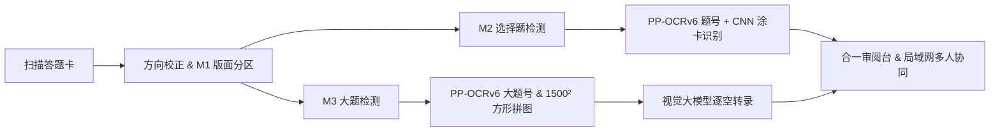

# 自动改卷

> **叠甲声明：** 本 README 由 AI 代笔（作者本人很懒，连项目介绍都外包给 AI 了，有 AI 味属于正常现象）。至于「这项目到底好不好用、能不能直接上生产」，先贴一张图表达我的严谨态度：

<p>
  
</p>

将扫描答题卡转换为可逐题核对的结构化识别结果，完整覆盖**本地分层版面检测、印刷题号与涂卡识别、方形拼图手写转录、可视化合一审阅（原地调框）及局域网多人协同**。

- **开源协议与权重说明**：本仓库**代码采用 [MIT License](LICENSE) 开源**（仅约 **2 MB**，秒级克隆）；自训纯推理权重包（**45.7 MB** 单文件，AES-256 加密）作为附件托管在 [GitHub Releases](https://github.com/KJNSAIUDHWI/my_first_project/releases/tag/v2026.11.27)，**权重暂不公开开源，如需解压密码请联系维护者邮箱：`lkqxsdggyx@gmail.com`**。官方 `PP-OCRv6` 印刷题号模型由脚本直接从百度飞桨官方源拉取。
- **当前适用边界**：支持选择题、填空题与实验题识别核对；已在高中物理标准答题卡版式验证（切换其他学科或全新版式需补充少量标注微调）。标准答案自动评分与成绩导出尚未接入。
- **快速索引**：[使用说明](docs/使用说明.md) · [审阅与协作指南](docs/审阅与协作指南.md) · [架构说明](docs/架构说明.md) · [开发说明](docs/开发说明.md) · [迭代指南](docs/迭代指南.md) · [Agent 维护指南](docs/Agent维护指南.md) · [项目成本与效能说明（可选）](docs/项目成本与效能说明.txt)

---

## 快速开始（CMD 一键拉取）

环境要求：Python 3.10+（推荐 Python 3.13），Windows 下打开 **CMD** 依次执行：

```bat
:: 1. 克隆纯代码仓库（约 2 MB）
git clone https://github.com/KJNSAIUDHWI/my_first_project.git 自动改卷
cd 自动改卷

:: 2. 创建虚拟环境并安装依赖（国内可加 -i https://pypi.tuna.tsinghua.edu.cn/simple）
python -m venv .venv
.venv\Scripts\activate
pip install -r requirements.txt

:: 3. 拉取百度官方 PP-OCRv6 + 下载 GitHub Release 精简推理权重（45.7 MB）并按提示输密码解压
python tools\下载权重.py

:: 4. 配置大模型 API 密钥（复制 .env.example 为 .env，或启动工作台后在网页里填写）
copy .env.example .env
```

> 如未安装 Git 或命令行下载 Release 较慢，可点击右上角 **Code → Download ZIP** 下载源码，再手动从 [Releases](https://github.com/KJNSAIUDHWI/my_first_project/releases/tag/v2026.11.27) 下载 `autograde_weights_v20261127.7z` 放入 `weights/` 后运行 `python tools\下载权重.py`（详见 [权重说明](weights/说明.txt)）。

### 启动工作台或 CLI

- **桌面控制中心（推荐日常使用与多人协作）**：
  直接双击根目录 `自动改卷工作台.exe`，或运行：
  ```bat
  python tools\工作台.py serve --open
  ```
  内建环境自检（自动测速选源补包）、**「⚙ 大模型 API」可视化配置**（支持豆包 / 小米 MiMo / DeepSeek / 通义千问 / 智谱 / 自定义 OpenAI 兼容接口）、标准化试卷入库、一键自动识别与局域网多人协同入口，各工具右上角均内置交互式 `? 新手教程`。

- **纯命令行流水线（适合批处理与二次开发）**：
  ```bat
  :: 统一工作台 CLI（与网页控制中心 1-to-1 等价，带 SSE 实时联动）
  python tools\工作台.py check
  python tools\工作台.py ingest --source "D:\papers" --subject 物理
  python tools\工作台.py run
  python tools\工作台.py status

  :: 或直接调用底层识别脚本与审阅服务
  python -B pipeline\run.py --recognize --input "D:\papers" --out "D:\grading-results\run-001" --concurrency 4
  python -B tools\识别验收.py --dir "D:\grading-results\run-001" --port 8904 --lan
  ```

> 公开仓库不包含真实试卷、训练数据或 API 密钥；首次运行请导入本地扫描图片目录。

---

## 核心特性与处理流程



- **三级本地视觉检测**：自动方向校正 → M1 版面分区 → M2 选择题检测（`PP-OCRv6` 印刷题号 + 几何连续性序列补全 + 本地 CNN 多选涂卡读取）→ M3 填空/实验大题检测。
- **低成本方形拼图与多运营商 VLM**：大题裁图紧凑拼入约 `1500×1500` 方图，默认 4 并发调用 OpenAI 兼容视觉大模型，内建严格 JSON 校验与按图块缓存断点续跑（实测 10 页约 36.8 秒、约 0.045 元，详见 [性能测试](docs/性能测试.md)）。当前规则对含图片/示意图的小题整小题标记舍弃，其余小题正常识别。
- **合一审阅与原地调框工作台（8904）**：左侧整页原卷零遮挡展示，右侧浮动答案卡片对齐卷面；按 `E` 原地切入调框模式修正检测框，按 `Alt` 暂隐叠层核对原字，按 `L` 逐个脉冲定位低置信度框（精确标注来源模型/规则，支持一键「信任无误」），按 `D` 保存并翻下一页。
- **局域网多人协同（`--lan`）**：同局域网下其他电脑或平板直接打开浏览器即可加入领卷核对，内置页级动态领卷、5 分钟租约锁与 3 秒实时同步，避免重复审阅与撞车。

---

## 文档导航

| 文档 | 内容 |
|---|---|
| [使用说明](docs/使用说明.md) | 环境安装、权重下载恢复、多运营商 API 配置、识别命令与审阅操作 |
| [审阅与协作指南](docs/审阅与协作指南.md) | 协作者日常看卷、低置信度定位、原地调框、问题反馈与局域网分工 |
| [架构说明](docs/架构说明.md) | 各检测/识别模块职责、拼图提示词规则、匹配与断点恢复机制 |
| [开发说明](docs/开发说明.md) | 目录结构、核心入口、自动化测试、模型管理与提交规范 |
| [迭代指南](docs/迭代指南.md) | 错例归因、标注审核、快照训练、新旧对比与换模型流程 |
| [Agent 维护指南](docs/Agent维护指南.md) | AI / 新维护者接手顺序、数据结构约定与标准操作命令 |
| [性能测试](docs/性能测试.md) | 10 页与 200 页实测耗时、token 消耗及费用明细 |
| [权重说明](weights/说明.txt) | Release 精简推理权重包校验、解压与官方 `PP-OCRv6` 拉取说明 |
| [项目成本与效能说明](docs/项目成本与效能说明.txt) | 可选阅读：项目来历、前期标注规模账本与投入产出记录 |

---

## 正事说完了，下面是监工的私货

既然是我的仓库，夹带点私货：安利一下**《无职转生》**。这作品有些下流的地方还真深得我心，属于是臭味相投了，哈哈。

后宫番看过不少，《约会大作战》之类的也都看过，但这么有实力的后宫番还是头一回见：叙事流畅，人物关系在故事里居然逻辑上说得通。太猎奇了，看到最后甚至想自嘲一句——我的道德水平还真有够低下。Anyway，好这口的可以看看，以上纯属本人私人审美，AI 负责代打。

<p>
<a href="https://mushokutensei.jp/news/230526_1/"></a>
<a href="https://mushokutensei.jp/news/230730_1/"></a>
</p>

图片来源：[第二季官方宣传图](https://mushokutensei.jp/news/230526_1/)、[拉诺亚魔法大学篇官方宣传图](https://mushokutensei.jp/news/230730_1/)。©理不尽な孫の手/MFブックス/「無職転生Ⅱ」製作委員会。
