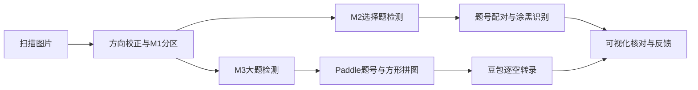

# 自动改卷

将扫描答题卡转换为可逐题核对的识别结果。目前支持选择题、填空及实验题，包含本地检测、手写转录和可视化验收。标准答案整理、评分及成绩导出尚待接入。

## 功能

- 方向检查与校正，M1版面分区、M2选择题检测、M3大题检测。
- Paddle印刷题号识别、本地涂黑识别和题号配对。
- 大题裁图紧凑拼入约1500×1500方图，交给豆包Lite转录，默认4并发。
- 原卷缩放平移、选择答案叠加、逐空核对、实际拼图追溯。
- 人工反馈与草稿保存，Esc逐级返回，处理错误直接显示原因。
- 按图块保存API成功结果，同一批次中断后可续跑。

## 快速开始

1. 克隆仓库，并按[使用说明](docs/使用说明.md)安装Python依赖。
2. 下载[weights目录](weights/)中的全部加密分卷，按[恢复说明](weights/说明.txt)解压到项目根目录。密码由项目持有人提供。
3. 在项目根目录的 `.env` 中配置 `ARK_API_KEY`，或设置同名环境变量。
4. 准备自己的扫描图片目录，在项目根目录运行：

```powershell
python -B pipeline/run.py --recognize --input "../papers" --out "../grading-results/run-001"
python -B tools/识别验收.py --dir "../grading-results/run-001" --port 8903
```

在浏览器打开 <http://127.0.0.1:8903/> 查看结果。图片已转正时，识别命令可加 `--working-images`，保留原像素。

仓库不包含试卷、训练数据或API密钥。克隆后的首次运行请使用 `--input` 指定图片目录；默认内部回归名单不随源码发布。

## 流程



当前转录规则会整体舍弃包含图片或示意图的小题，其他小题继续识别；正反面分别处理，不自动合并学生身份。详细规则见[架构说明](docs/架构说明.md)。

## 性能记录

2026-11-01的10页连续测试耗时 **36.8秒**，包含首次模型加载；14次API请求全部成功，估算费用 **约0.045元**。测试使用已转正物理答题卡、CPU FP32、豆包Lite非思考模式和4并发。各阶段耗时及200页记录见[性能测试](docs/性能测试.md)。

## 文档

| 文档 | 内容 |
|---|---|
| [使用说明](docs/使用说明.md) | 环境安装、权重恢复、密钥配置、识别与结果查看 |
| [架构说明](docs/架构说明.md) | 检测分工、转录规则、结果追溯及恢复机制 |
| [开发说明](docs/开发说明.md) | 代码入口、测试和模型管理 |
| [性能测试](docs/性能测试.md) | 实测耗时、token及费用记录 |
| [权重恢复](weights/说明.txt) | 分卷校验、解压与部署文件清单 |
