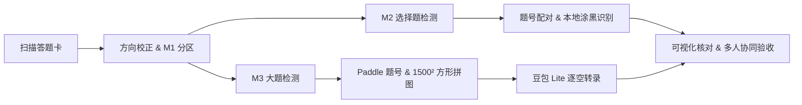

# 自动改卷

> **叠甲声明：** 本 README 由 AI 代笔（作者本人很懒，连项目介绍都外包给 AI 了，有 AI 味属于正常现象）。至于「这项目到底好不好用、能不能直接上生产」，先贴一张图表达我的严谨态度：

<p>
  
</p>

将扫描答题卡转换为可逐题核对的电子识别结果。目前支持**选择题、填空题与实验题**，完整覆盖本地版面检测、涂黑识别、方形拼图转录、可视化人工验收以及家庭局域网多人协同核对。标准答案整理、自动评分及成绩导出尚待后续接入。

- **母后与家人从这里开始：** [图文交互教程（浏览器直接打开）](docs/父母使用图文教程.html) · [母后使用指南](docs/母后使用指南.md) · [模型怎么越用越好](docs/迭代指南.md)
- **AI / 维护者接手：** 先读 [AGENTS.md](AGENTS.md) 与 [Agent 维护指南](docs/Agent维护指南.md)
- **代码仓库与权重分离：** 本仓库仅托管源码与文档（约 **2 MB**，秒级克隆）；自训纯推理权重包（**45.7 MB** 单文件，AES-256 加密）作为附件托管在 [GitHub Releases](https://github.com/KJNSAIUDHWI/my_first_project/releases/tag/v2026.11.27)，官方 `PP-OCRv6` 印刷题号模型由脚本直接从百度飞桨官方源拉取。

---

## CMD 一键下载代码与权重

打开 Windows **CMD（命令提示符）**，直接复制粘贴以下 3 行命令即可完成代码拉取与权重准备：

```bat
git clone https://github.com/KJNSAIUDHWI/my_first_project.git 自动改卷
cd 自动改卷
python tools\下载权重.py
```

- 第 1 行：克隆全部代码与工具（约 2 MB，几秒完成）。
- 第 3 行：自动从百度飞桨官方源拉取 `PP-OCRv6`（约 73 MB），并从 [GitHub Releases](https://github.com/KJNSAIUDHWI/my_first_project/releases/tag/v2026.11.27) 下载精简纯推理权重包 `autograde_weights_v20261127.7z`（45.7 MB）；输入密码后自动解压到 `models/`。
- 如未安装 Git 或 GitHub 命令行下载较慢，也可直接点击右上角 **Code → Download ZIP** 下载源码，再手动从 [Releases](https://github.com/KJNSAIUDHWI/my_first_project/releases/tag/v2026.11.27) 下载 `autograde_weights_v20261127.7z` 放到 `weights/` 目录后运行 `python tools\下载权重.py`（详见 [权重恢复说明](weights/说明.txt)）。

---

## 核心特性

- **三级本地视觉检测**：自动方向校正 → M1 版面分区 → M2 选择题检测、Paddle 印刷题号与本地涂黑识别配对 → M3 填空及实验大题检测。
- **低成本方形拼图转录**：将大题裁图紧凑拼入约 `1500×1500` 方图，默认 4 并发交给豆包 Lite 逐空转录，大幅压低 API 单页费用。
- **可视化人工验收台**：左侧整页原卷无级缩放平移并直接叠加选择题答案，右侧逐题裁图对比，支持一键标对 / 记错、草稿自动保存与 `Esc` 逐级返回。
- **局域网多人协同（`--lan`）**：主机一行命令开启共享，同一路由器下另一台电脑打开浏览器即可一起领卷核对或画框，内置动态领卷与 5 分钟租约锁，互不撞车。
- **断点续跑**：API 成功结果按图块缓存在本地，同一批次中断后可直接续跑，不浪费额度。

---

## 处理流程



当前转录规则会整体舍弃包含图片或示意图的小题，其余小题继续识别；正反面独立处理，不自动合并学生身份。详细规则见 [架构说明](docs/架构说明.md)。

---

## 快速开始

### 方式一：一键桌面工作台（推荐父母与日常使用）

1. 按上方 CMD 命令克隆代码并拉取权重后，直接双击根目录的 **`自动改卷工作台.exe`**（首次如弹出 Windows SmartScreen 提示，点「更多信息 → 仍要运行」；也可运行 `tools\工作台\创建桌面快捷方式.ps1` 本机编译并生成桌面快捷方式）。
2. 启动后自动进入**环境自检**：
   - 缺 Python 依赖 → 一键自动测速对比 PyPI 官方源与清华/阿里云镜像并安装；
   - 缺模型权重 → 将 [Releases](https://github.com/KJNSAIUDHWI/my_first_project/releases/tag/v2026.11.27) 的 `autograde_weights_v20261127.7z` 放入 `weights/` 后，直接在页面输入密码解压（并自动从百度官方源补齐 `PP-OCRv6`）；
   - 缺大模型密钥 → 直接在页面点击「⚙ 大模型 API」配置豆包 / MiMo / DeepSeek / 通义千问 / 自定义中转站，自动写入本地 `.env`；
   - 遇到疑难问题 → 一键复制结构化诊断提示词并唤起本机 `opencode` 等 AI 助手。
3. 随后按页面引导完成 **录入新试卷（非破坏性复制、SHA256 去重、`日期_学科_序号.jpg` 统一命名）→ 控制总览 & 局域网多人协作**（右上角内置 `? 新手引导` 交互式试卷解剖图与聚光灯导览）：
   - **人工复审（整页核对）**：整批缩略图墙支持 **按住 `Ctrl + 滚轮` 缩放**；点进具体试卷可核对答案、可选开关查看具体置信度数值，发现框画歪可直接点 **「✎ 修改这张卷的标框」** 弹出单张标框子界面修改；
   - **涂黑答案审核**：整批平铺刷选择题填涂；
   - **局域网多人协作**：家里另一台电脑/平板直接用浏览器打开主机显示的 `http://192.168.x.x:8888` 即可加入，自动区分主机与协作者权限并统计不同人的审阅工作量。

### 方式二：等价命令行（推荐开发者与 AI Agent）

工作台所有界面操作均映射到统一 CLI `tools/工作台.py`，执行时会自动通过 SSE 实时高亮联动已打开的工作台页面：

```powershell
# 启动控制中心（本机主控 + 局域网协作）
python tools/工作台.py serve --open

# 环境自检 / 测速补包 / 生成 AI 诊断提示词
python tools/工作台.py check
python tools/工作台.py repair-pip
python tools/工作台.py agent-prompt --launch

# 标准化入库（不改原图、去重、统一命名）→ 自动识别 → 查看总览进度
python tools/工作台.py ingest --source "D:/papers" --subject 物理
python tools/工作台.py run
python tools/工作台.py status
```

> 公开仓库不包含真实试卷、训练数据或 API 密钥；首次运行请导入自己的图片目录。

---

## 性能记录

2026-11-01 对 **10 页**已转正物理答题卡连续测试（CPU FP32 · 豆包 Lite 非思考模式 · 4 并发）：

- **总耗时**：**36.8 秒**（含首次模型加载）
- **API 请求**：14 次全部成功
- **估算费用**：**约 0.045 元**（约 4.5 元 / 千页）

各阶段耗时及 200 页测试记录见 [性能测试](docs/性能测试.md)。

---

## 文档导航

| 文档 | 内容 |
|---|---|
| [父母使用图文教程](docs/父母使用图文教程.html) | 单文件离线交互式图文教程，带界面分步高亮导览 |
| [母后使用指南](docs/母后使用指南.md) | 日常看卷、记录问题与反馈提交 |
| [使用说明](docs/使用说明.md) | 环境安装、权重恢复、密钥配置、识别与结果查看 |
| [迭代指南](docs/迭代指南.md) | 预标注、人工改框、训练、比较与换模型的分工 |
| [Agent 维护指南](docs/Agent维护指南.md) | AI 接手顺序、数据约定、局域网协同命令与发布检查 |
| [架构说明](docs/架构说明.md) | 检测分工、转录规则、结果追溯与恢复机制 |
| [开发说明](docs/开发说明.md) | 代码入口、自动化测试与模型管理 |
| [性能测试](docs/性能测试.md) | 实测耗时、token 及费用记录 |
| [权重恢复](weights/说明.txt) | 分卷校验、解压与部署文件清单 |

---

## 谁在写？写给谁？

电子信息类在读大学生一枚。这个项目最开始的动机很朴素：想给**母后**做个工具，让她平时少改点卷子。

代码基本由 **DeepSeek、GPT、Gemini** 轮流代工，我负责当**赛博监工**——提需求、定流程、盯效果，发现哪里不对就喊它们回来返工。代码可以不用全自己写，但哪里难用必须心里有数：大题得拼成方图发才省钱、选择题答案得印回原卷才不费眼、题号不能串、划掉的字不能算答案、一家人连着 Wi-Fi 一起核对时不能撞车。

### 监工也得下工地

模型可以先预标注画框，但歪了、漏了、多画了，还得靠肉眼一张张审。按 2026-11-03 的本地日志核对，M1 / M2 / M3 当前已审核结果共 **85,234 个框**。

我还真去闲鱼询过价：**0.09 元一个框**，不是拍脑袋按出来的数字。如果全部从零外包画，账单大概长这样：

| 已审核标注 | 框数 | 从零外包等价金额 |
|---|---:|---:|
| M1 版面分区 | 7,763 | 698.67 元 |
| M2 题号、选项 | 60,183 | 5,416.47 元 |
| M3 大题及题号 | 17,288 | 1,555.92 元 |
| **合计** | **85,234** | **7,671.06 元** |

同期模型、API 和订阅大概花了 **805 元**；日志里能追溯或重建出 **11,459 次**手动改框（同样按 0.09 元/次折算是 **1,031.31 元**）。顺手算笔杠杆账：

| 口径 | 计算方式 | 约数 |
|---|---|---:|
| 资金杠杆 | `7,671.06 ÷ 805` | **9.53 倍** |
| 标注修改杠杆 | `7,671.06 ÷ 1,031.31` | **7.44 倍** |
| 合并折算 | `7,671.06 ÷ (805 + 1,031.31)` | **4.18 倍** |

钱花给模型了，眼睛还是自己的——**赛博监工，人工验收**。第一次把一个想法折腾成真能跑起来的东西，先记在这里，后面继续迭代，争取让母后觉得这玩意儿确实有点用。

<details>
<summary>账怎么算的？点开查账</summary>

框数按每张图最终已审核结果计一次，不重复累计审核轮次。修改数包括新增 2,150 次、调整 6,696 次、删除 2,613 次，包含多轮修改；旧日志部分通过前后框比较重建，不是鼠标点击次数。

0.09 元/框为实际闲鱼询价；将每次修改也按 0.09 元算，是为了统一比较。805 元是订阅与 API 支出的约数。这些只是金额折算，没把逐图浏览、流程设计和验收工时算进去，不能当成实际收益或工时提效。公开仓库只放汇总，真实试卷和逐图审核日志都留在本地。

</details>

---

## 正事说完了，下面是监工的私货

既然是我的仓库，夹带点私货：安利一下**《无职转生》**。这作品有些下流的地方还真深得我心，属于是臭味相投了，哈哈。

后宫番看过不少，《约会大作战》之类的也都看过，但这么有实力的后宫番还是头一回见：叙事流畅，人物关系在故事里居然逻辑上说得通。太猎奇了，看到最后甚至想自嘲一句——我的道德水平还真有够低下。Anyway，好这口的可以看看，以上纯属本人私人审美，AI 负责代打。

<p>
<a href="https://mushokutensei.jp/news/230526_1/"></a>
<a href="https://mushokutensei.jp/news/230730_1/"></a>
</p>

图片来源：[第二季官方宣传图](https://mushokutensei.jp/news/230526_1/)、[拉诺亚魔法大学篇官方宣传图](https://mushokutensei.jp/news/230730_1/)。©理不尽な孫の手/MFブックス/「無職転生Ⅱ」製作委員会。
