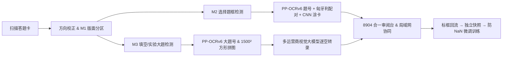

# 自动改卷

> **叠甲声明：** 本 README 由 AI 代笔（作者本人很懒，连项目介绍都外包给 AI 了，有 AI 味属于正常现象）。至于「这项目到底好不好用、能不能直接上生产」，先贴一张图表达我的严谨态度：

<p>
  
</p>

将扫描答题卡转换为可逐题核对的结构化识别结果，打通 **本地三级版面检测 → 印刷题号与涂卡识别 → 方形拼图手写转录 → 合一网页审阅与局域网协同 → 标框同步与本地微调训练** 的完整工程闭环。

- **开源协议与权重说明**：本仓库**代码采用 [MIT License](LICENSE) 开源**（纯代码仅约 **2 MB**，秒级克隆）；自训纯推理权重包（**45.7 MB** 单文件，AES-256 含文件名加密）托管在 [GitHub Releases (`v2026.11.27`)](https://github.com/KJNSAIUDHWI/my_first_project/releases/tag/v2026.11.27)，**权重暂不公开开源，如需解压密码请联系维护者邮箱：`lkqxsdggyx@gmail.com`**。官方 `PP-OCRv6` 印刷题号 ONNX 模型由脚本直接从百度飞桨官方源拉取。
- **适用边界**：支持选择题、填空题与实验题识别核对；已在高中物理标准答题卡版式验证（切换新学科或新版式可在工作台「第 4 步：模型训练」中补充少量标注并微调）。标准答案自动判分与成绩导出留待后续扩展。
- **想看项目背景、AI 监工心得、成本杠杆账本与作者私货** → 请移步 [**作者的吹牛时间**](docs/作者的吹牛时间.md)。

---

## 一、CMD 命令行一键拉取与配置

环境要求：Windows x64 + Python 3.10+（推荐 Python 3.13）；本地推理与训练均**自动优先检测并使用本机 CUDA GPU**（无可用显卡时自动回退 CPU），可在工作台第 1 步一键本机测速选出最优并发与批大小。打开 **CMD** 依次执行：

```bat
:: 1. 克隆纯代码仓库（约 2 MB）
git clone https://github.com/KJNSAIUDHWI/my_first_project.git 自动改卷
cd 自动改卷

:: 2. 创建虚拟环境并安装依赖（国内可加 -i https://pypi.tuna.tsinghua.edu.cn/simple）
python -m venv .venv
.venv\Scripts\activate
pip install -r requirements.txt

:: 3. 拉取百度官方 PP-OCRv6 + 下载 GitHub Release 精简推理权重（45.7 MB）并按提示输密码解压
python tools\下载权重.py

:: 4. 配置视觉大模型 API 密钥（复制 .env.example 为 .env，或在工作台网页右上角可视化填写）
copy .env.example .env
```

> **手动下载兜底**：如命令行访问 GitHub 较慢，可先点右上角 **Code → Download ZIP** 下载源码，再从 [Releases](https://github.com/KJNSAIUDHWI/my_first_project/releases/tag/v2026.11.27) 手动下载 `autograde_weights_v20261127.7z` 放进 `weights/` 目录，然后执行 `python tools\下载权重.py`（或打开工作台点「输入密码解压加密权重」）。校验指纹见 [`weights/SHA256SUMS.txt`](weights/SHA256SUMS.txt) 与 [`weights/部署清单_20261127.json`](weights/部署清单_20261127.json)。

---

## 二、怎么用：桌面工作台（推荐）与纯命令行

### 方式 A：双击 `自动改卷工作台.exe`（四步完整闭环）

直接双击根目录 `自动改卷工作台.exe`，或命令行执行 `python tools\工作台.py serve --open`（默认端口 `8888`），网页内置 4 步主轴与交互式 `? 新手引导`：

1. **运行环境**：自检 Python 依赖（支持真实导入校验与 `paddleocr`/`numpy`/`opencv` 版本冲突检查）、6 个自训模型、官方 `PP-OCRv6` 与 API 密钥；支持自动测速选源补包、输密码解压权重、右上角 **「⚙ 大模型 API」** 可视化配置（含带图视觉连通性测试），以及**推理设备切换与一键本机 Batch/并发性能压测（零 API 费用）**。
2. **导入试卷**：选择本地扫描照片文件夹与学科，非破坏性复制 + SHA256 去重重命名，并一键启动流式并发自动识别流水线（边检测边拼图边调用 API、实时增量合并结果）。
3. **审阅与协作**：实时展示**中文 5 模块可视化进度面板**（页面纠偏 / M1 / M2 / M3 / 大模型拼图转录）与**中文错误/退出码诊断卡**，支持**一键补跑失败图块**（不重复扣费）；一键打开 **合一审阅台（`8904`）** 与 **涂卡批量审核（`8905`）**；填空题默认**鼠标悬停就近显示答案**（顶栏可切「右侧列表」），学生未填写的空位明确标示「**未作答**」胶囊；同局域网下的其他电脑/平板打开主机网址即可免安装加入领卷，内置 **页级动态领卷 + 5 分钟租约锁 + 3 秒实时同步**。
4. **模型训练**：支持一键将当前批次已确认审阅页的 **M1 / M2 / M3** 标框同步入库（或直接切换 M1 / M2 / M3 打开 `8900` 批量标框），选择模块与轮数启动**带防 NaN 数值保护的微调训练**，实时查看日志与 `8901` 训练监控；训练完成后需人工核对指标并手动点击 **「启用此权重」**（切换前自动备份上一版，随时一键回退）。

#### 合一审阅台（`8904`）常用快捷键

| 操作 | 快捷键 / 鼠标 |
|---|---|
| 放大 / 缩小原卷 | 滚轮缩放 |
| 平移原卷画布 | 按住中键拖动 / 按住右键拖动 / `空格 + 左键拖动` |
| 暂隐所有叠层看原字 | 按住 **`Alt`** |
| 定位下一个低置信度框（`低置`） | **`L`**（弹窗标明来源模型/规则，确认无误点 `✓ 信任无误`） |
| 切换审阅 / 原地调框模式 | **`E`**（拖边角调框、空白拖画新框、右键短按 `<5px` 删框） |
| 保存当前页并跳下一张待审 | **`D`**（上一页 **`A`**） |

### 方式 B：纯命令行跑批

```bat
:: 完整识别（默认 --device auto 优先用 GPU；支持断点续跑，已成功缓存的 API 图块不重复扣费）
python -B pipeline\run.py --recognize --input "D:\papers" --out "D:\grading-results\run-001" --device auto --concurrency 4

:: 仅补跑失败/结构异常图块（已成功项绝不重复扣费）
python -B tools\补跑失败图块.py --dir "D:\grading-results\run-001"

:: 本机推理 Batch 与并发压测（零 API 费用，自动推荐最优参数）
python -B tools\性能压测.py --samples 4

:: 启动合一审阅与局域网协同服务
python -B tools\识别验收.py --dir "D:\grading-results\run-001" --port 8904 --lan
```

---

## 三、项目设计架构与核心思路



项目围绕 **“低成本、可控精度、敢信任、能迭代”** 四个工程约束设计：

1. **三级级联检测 + 专模专用（把客观题完全留在本地 CPU）**
   不把整张试卷直接扔给视觉大模型（既贵又慢、还容易题号串行产生幻觉），而是拆成 **方向校正 → M1 版面分区（身份/选择/填空）→ M2 选择题（`PP-OCRv6` 读印刷题号 + 匈牙利算法一对一几何配对 + 几何连续性序列推算补全 `fix_no=True` + 本地轻量 CNN 读多选涂卡）→ M3 填空/实验大题裁切**。选择题 100% 在本地 CPU 毫秒级完成，零 API 费用。
2. **`1500×1500` 方形紧凑拼图 + 强约束 Prompt（把 VLM 费用压到几分钱）**
   大题裁图按独立图块 ID 紧凑拼入约 `1500×1500` 方图（等比不拉伸、同题号跨页绝不合并），默认 4 并发调用 OpenAI 兼容视觉大模型。Prompt 针对真实试卷踩坑做了显式约束：**划掉重写只取最终答案、印刷子题号 `(4)①→4.1`、含图片/示意图的小题整小题舍弃、LaTeX 反斜杠双写防 `\f` 变控制符**，配套 `strict_json` 拒绝重复键校验与按请求指纹缓存断点续跑（实测 10 页约 36.8 秒、约 0.045 元）。
3. **“不盲信 AI”的人机协同闭环**
   OCR 项目最怕错检混进最终结果。本系统将 YOLO 低置信度框、CNN 浅涂卡、序列推算题号（`no_source="sequence"`）、未配对框及 VLM 异常统一归因到具体题目框，在 `8904` 零遮挡网页里按 `L` 逐个脉冲定位核对；发现漏框/歪框直接按 `E` 原地修改，无需切软件。
4. **推理反馈与训练快照严格隔离**
   审阅页改答案只写入当批结果目录（`feedback.json`），绝不直接污染训练集；需要微调模型时，由工作台第 4 步显式同步已确认框 → 按父页无泄露划分 `train/val` 独立快照 → 通过 `GradGuardTrainer`（梯度/非有限值保护）+ `run_training.supervise()` 检查权重有限性后留档，再由人工确认切换部署。

---

## 四、核心代码地图与排错速查

### 真正在用的核心模块

| 层次 | 关键文件 | 职责 |
|---|---|---|
| **权重管理** | `tools/下载权重.py`、`pipeline/common/model_registry.py`、`weights/` | 官方 `PP-OCRv6` + Release 加密推理权重拉取、SHA256 校验、当前部署解析与发布 |
| **流水线总控** | `pipeline/run.py`、`pipeline/recognize.py`、`pipeline/common/runtime_diag.py` | GPU 优先批量流式并发识别、实时增量合并、中文错误诊断与语义化退出码 |
| **本地视觉检测** | `pipeline/orient/deskew.py`、`pipeline/m1/`、`m2/`、`m3/` | 方向与小角度校正、三级 YOLO 检测与防 NaN 训练脚本 |
| **选择题与配对** | `pipeline/stages/match.py`、`choice.py`、`pipeline/cnn/printed_number.py`、`choice.py` | 匈牙利配对、序列题号补全、批量 `PP-OCRv6` ONNX 题号读取与批量多选涂卡 CNN |
| **拼图与补跑/压测** | `pipeline/common/recognition_api.py`、`tools/补跑失败图块.py`、`tools/性能压测.py` | `1500²` 紧凑拼图、多运营商视觉调用、失败图块无重复扣费补跑与本机压测 |
| **合一审阅与协同** | `tools/识别验收.py`、`tools/识别验收.html`、`pipeline/common/lan_collab.py` | `8904` 悬停/列表双模式审阅、未作答胶囊、原地调框（`E`）、低置信度定位（`L`）与局域网租约锁 |
| **桌面工作台与训练** | `自动改卷工作台.exe`、`tools/工作台/`（`serve.py`、`core.py`、`train_bridge.py`、`index.html`） | `8888` 四步控制中心、标框回流同步、一键微调训练、权重切换与一键回退 |

### 常见问题与基础回归测试

| 现象 | 排查方式 |
|---|---|
| 缺少模型权重 | 运行 `python tools\下载权重.py`，或检查 `models/` 下 6 个 `.pt` 与 `PP-OCRv6` 是否已就位 |
| 缺少 Python 依赖 | 运行 `pip install -r requirements.txt`，或在工作台第 1 步点击自动测速补包 |
| HTTP 401 / 403 鉴权失败 | 打开工作台右上角「⚙ 大模型 API」检查 Base URL、Model ID 与 API Key 并点「测试连通性」 |
| 平台额度耗尽中断 | 充值或调额后用相同命令重新运行即可，已成功的 API 图块缓存会自动复用不重复扣费 |
| 公式显示异常 | 页面会保留原始 LaTeX 文本；首次打开验收页会自动缓存本地 KaTeX 资源 |

安装依赖后，可直接运行不依赖真实试卷数据的核心单元测试：

```bat
python -B -m unittest pipeline.tests.test_choice_matching pipeline.tests.test_lan_collab pipeline.tests.test_eval_chain
```
