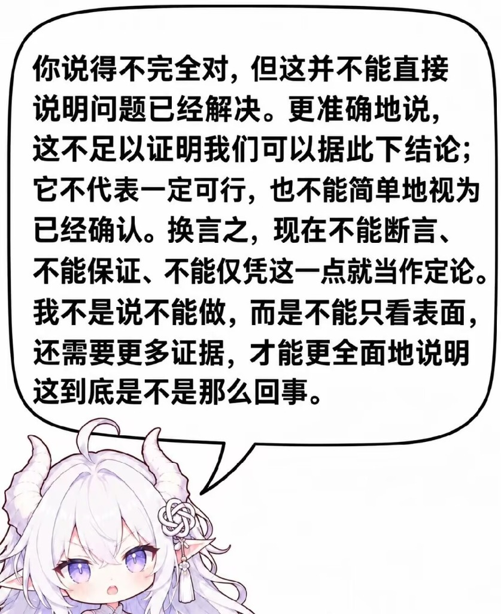
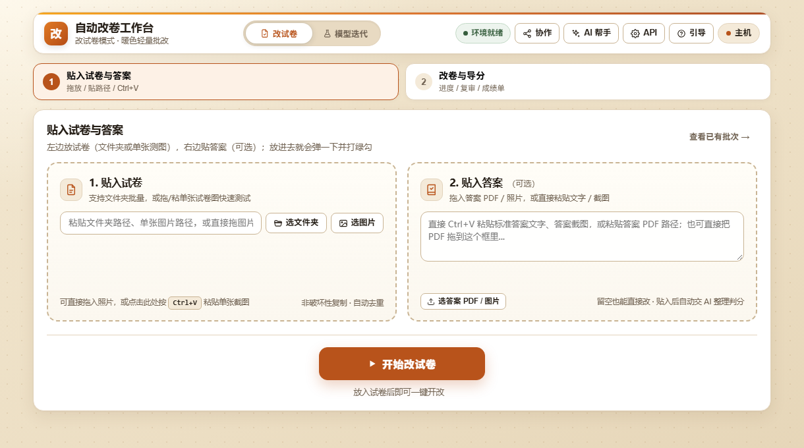
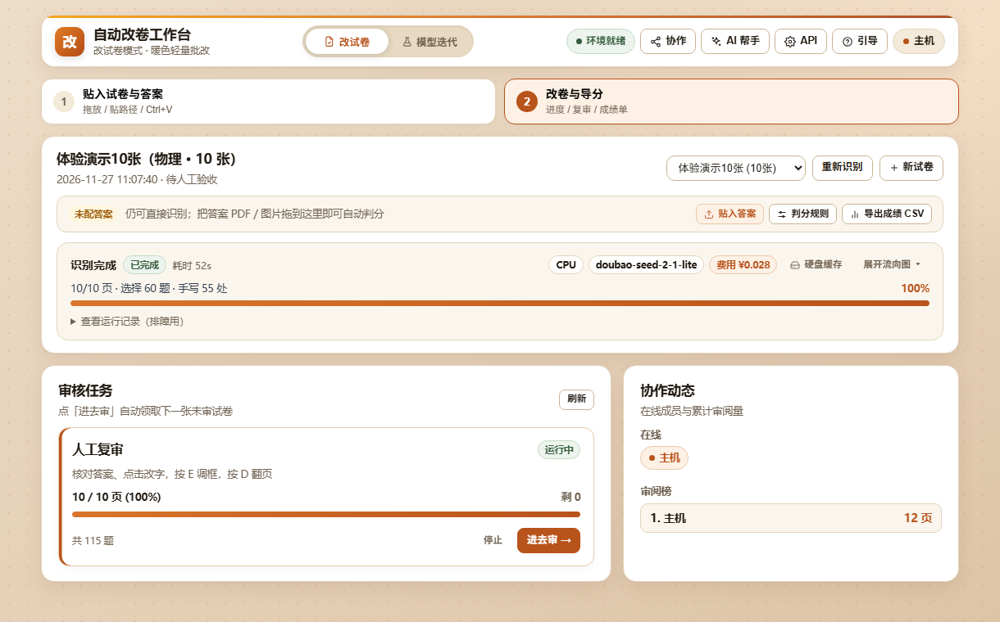
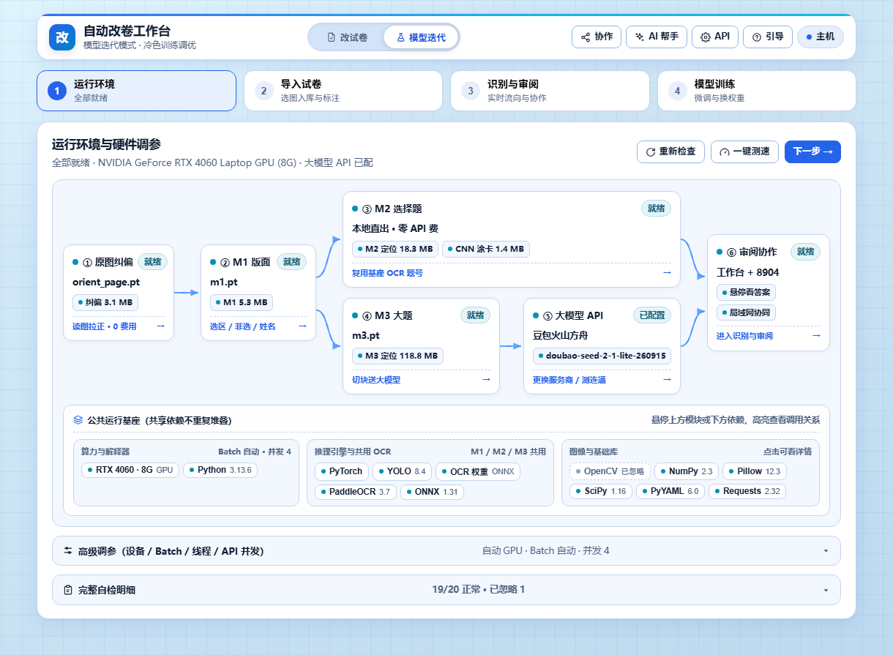
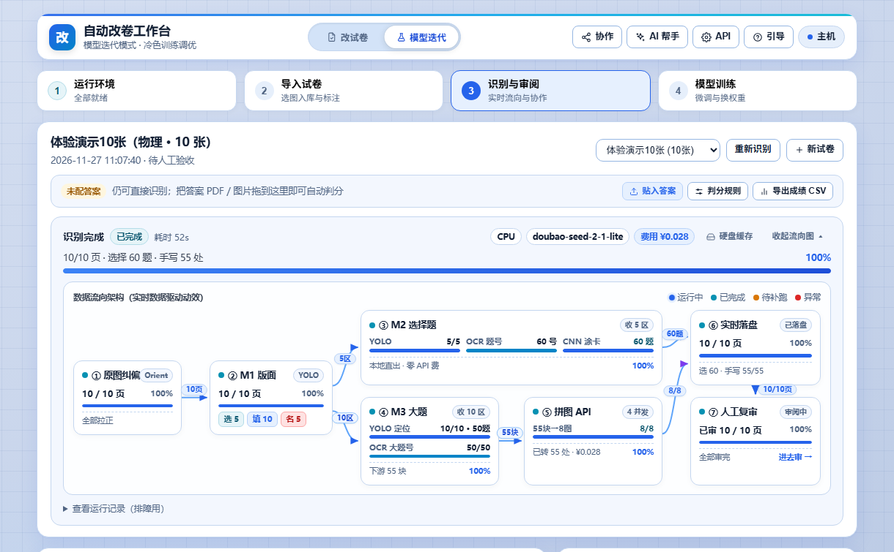
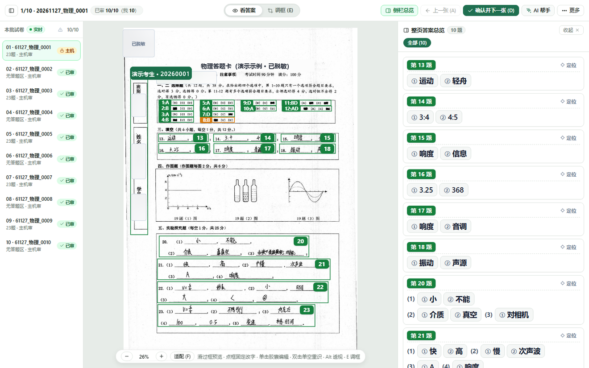
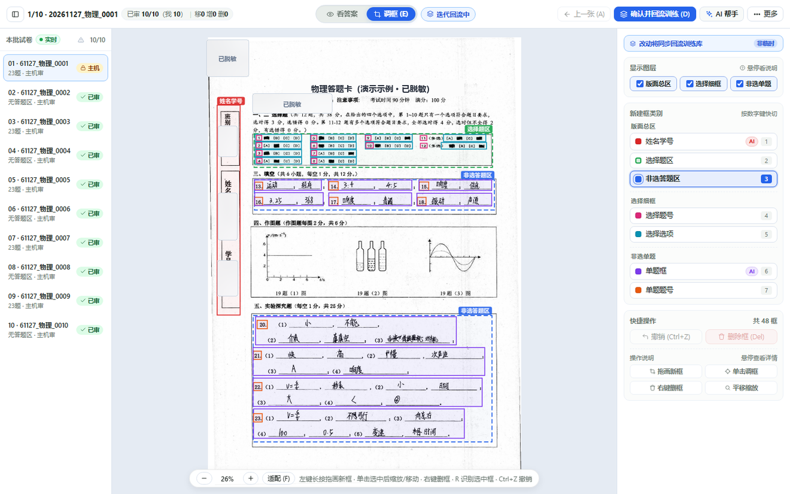
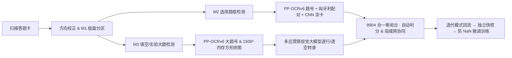

# 自动改卷

> **叠甲声明：** 本 README 由 AI 代笔（作者本人很懒，连项目介绍都外包给 AI 了，有 AI 味属于正常现象）。至于「这项目到底好不好用、能不能直接上生产」，先贴一张图表达我的严谨态度：

<p>
  
</p>

将扫描答题卡转换为可逐题核对、可自动判分的结构化识别结果，打通 **本地三级版面检测 → 印刷题号与涂卡识别 → 内存暂存方形拼图手写转录 → 合一网页审阅与局域网协同 → 自动判分导成绩单 → 标框回流与本地微调训练** 的完整工程闭环。

- **双工作模式与 UI 设计**：工作台内置 **「改试卷（暖色极简 2 步）」⇄「模型迭代（冷色工程 4 步）」** 双模式一键切换，配备点击落点高帧率水波揭屏、同色系逐步骤背景色阶、全站零 Emoji 统一 SVG 线性图标与可自由拖动的全局同构 AI 帮手。
- **开源协议与权重说明**：本仓库**代码采用 [MIT License](LICENSE) 开源**（纯代码轻量化，秒级克隆）；自训纯推理权重包（**45.7 MB** 单文件，AES-256 含文件名加密）托管在 [GitHub Releases (`v2026.11.27`)](https://github.com/KJNSAIUDHWI/my_first_project/releases/tag/v2026.11.27)，**权重暂不公开开源，如需解压密码请联系维护者邮箱：`lkqxsdggyx@gmail.com`**。官方 `PP-OCRv6` 印刷题号 ONNX 模型由脚本直接从百度飞桨官方源拉取。
- **适用边界**：支持选择题、填空题、实验题识别核对，以及**标准答案（PDF / 照片 / 文字 / JSON）自动整理判分与 Excel 成绩单 CSV 导出**（支持自定义多选题漏选给分比例）；已在物理标准答题卡版式验证，切换新学科或新版式可在工作台「模型迭代 → 模型训练」中补充少量标注并微调。
- **想看项目背景、AI 监工心得、成本杠杆账本、UI 审计战报与作者私货** → 请移步 [**作者的吹牛时间**](docs/作者的吹牛时间.md)。

---

## 界面与 UI 审美实拍（所有试卷实例均已完整脱敏）

<table>
  <tr>
    <td align="center" width="50%">
      <br>
      <sub><b>改试卷模式 · Step 1 贴入试卷与答案</b>（暖杏晨纸 · 拖放/贴路径/Ctrl+V · 居中主 CTA）</sub>
    </td>
    <td align="center" width="50%">
      <br>
      <sub><b>改试卷模式 · Step 2 改卷与导分</b>（温润陶沙 · 焦糖陶棕单色系 · 唯一主焦点「进去审 →」）</sub>
    </td>
  </tr>
  <tr>
    <td align="center" width="50%">
      <br>
      <sub><b>模型迭代 · Step 1 运行环境体检 DAG</b>（清透冰青蓝 · 6 节点独占权重 + 下方共享基座双向悬停联动）</sub>
    </td>
    <td align="center" width="50%">
      <br>
      <sub><b>模型迭代 · Step 3 实时数据流向架构图</b>（静谧钢青蓝 · 真实增量数据脉冲与费用估算）</sub>
    </td>
  </tr>
  <tr>
    <td align="center" width="50%">
      <br>
      <sub><b>8904 合一审阅台 · 审阅模式（已脱敏）</b>（双层 Canvas 60/144fps · 零遮挡原卷 · 逐行结构化答案侧栏）</sub>
    </td>
    <td align="center" width="50%">
      <br>
      <sub><b>8904 合一审阅台 · 原地调框 E（已脱敏）</b>（7 色高辨识度框色板 · 悬停说明 · 迭代模式自动回流训练库）</sub>
    </td>
  </tr>
</table>

---

## 一、CMD 命令行一键拉取与配置

环境要求：Windows x64 + Python 3.10+（推荐 Python 3.13）；本地推理与训练均**自动优先检测并使用本机 CUDA GPU**（无可用显卡时自动回退 CPU），可在工作台一键本机测速选出最优并发与批大小。打开 **CMD** 依次执行：

```bat
:: 1. 克隆纯代码仓库
git clone https://github.com/KJNSAIUDHWI/my_first_project.git 自动改卷
cd 自动改卷

:: 2. 创建虚拟环境并安装依赖（国内可加 -i https://pypi.tuna.tsinghua.edu.cn/simple）
python -m venv .venv
.venv\Scripts\activate
pip install -r requirements.txt

:: 3. 拉取百度官方 PP-OCRv6 + 下载 GitHub Release 精简推理权重（45.7 MB）并按提示输密码解压
python scripts\download_weights.py

:: 4. 配置视觉大模型 API 密钥（复制 .env.example 为 .env，或在工作台网页右上角可视化填写）
copy .env.example .env
```

> **手动下载兜底**：如命令行访问 GitHub 较慢，可先点右上角 **Code → Download ZIP** 下载源码，再从 [Releases](https://github.com/KJNSAIUDHWI/my_first_project/releases/tag/v2026.11.27) 手动下载 `autograde_weights_v20261127.7z` 放进 `weights/` 目录，然后执行 `python scripts\download_weights.py`（或打开工作台点「输入密码解压加密权重」）。校验指纹见 [`weights/SHA256SUMS.txt`](weights/SHA256SUMS.txt) 与 [`weights/manifest.json`](weights/manifest.json)。

---

## 二、怎么用：桌面工作台（推荐）与纯命令行

### 方式 A：双击 `自动改卷工作台.exe`（冷暖双模式工作台）

直接双击根目录 `自动改卷工作台.exe`，或命令行执行 `python apps\workbench\cli.py serve --open`（默认端口 `8888`）。顶栏模式胶囊可在两种工作形态间以圆形水波平滑切换：

- **改试卷模式（默认 · 暖色极简 2 步）**：面向日常改卷老师与协作者，隐藏训练与标框干扰、自动启用**内存暂存 Crop（不向硬盘写大量零碎小图）**、不创建本地训练库：
  1. **贴入试卷与答案**：左侧拖入/选择试卷文件夹或单张测试图（支持直接 `Ctrl+V` 贴截图/路径），右侧可选贴入标准答案（PDF / 照片 / 文字 / JSON），放好后自带确认回弹动效，点击居中大按钮 **「开始改试卷」** 一键开跑。
  2. **改卷与导分**：实时查看识别进度与 API 花费、一键补跑失败项（已成功缓存绝不重复扣费）、贴入答案自动整理判分规则（支持多选漏选比例配置）、一键导出带总分与逐题得分的 Excel 成绩单 CSV，点击唯一主按钮 **「进去审 →」** 进入 `8904` 审阅或点击顶栏 **「协作」** 邀请局域网同伴免安装同步领卷。
- **模型迭代模式（冷色完整 4 步）**：面向模型调优与换版式场景，双翼平滑展开 **「运行环境」** 与 **「模型训练」**：
  1. **运行环境**：采用与识别流水线完全同构的 **6 节点体检 DAG + 下方公共运行基座托盘**（共享依赖不重复堆叠，鼠标悬停任意节点或依赖双向高亮调用关系）；非阻塞版本兼容提醒支持按指纹一键忽略（版本变动自动重弹，可随时恢复）；内置自动测速选源补包、输密码解压权重、视觉大模型 API 可视化配置与零 API 费用本机性能压测。
  2. **导入试卷**：额外展开学科归档标签、自定义批次名与「仅入库（用于标注）」入口。
  3. **识别与审阅**：完整 7 节点实时数据流向架构图 + 真实数据脉冲动画，可选展开 M1/M2/M3 批量标框（`8900`）与涂卡审核（`8905`）。
  4. **模型训练**：统一管理本地训练数据库（支持自定义路径与 8904 回流开关），一键同步已确认标框，启动带 `GradGuardTrainer` 防 NaN 保护的微调训练，查看 `8901` 监控，核对后手动 **「启用此权重」**（自动备份旧版，随时一键回退）。
- **全局可拖动 AI 帮手**：`8888` 与 `8904` 共享非阻塞自由拖动/调尺寸浮窗，支持 ZCode / OpenCode / WorkBuddy / 豆包 CLI / Antigravity / 自定义模板多引擎并发对话、一键导入 `.env`/`.json` 配置、同构 CLI 操控页面、以及离屏无头视觉截图自检。

#### 合一审阅台（`8904`）常用快捷键

| 操作 | 快捷键 / 鼠标 |
|---|---|
| 放大 / 缩小原卷 | 滚轮缩放（**`F`** 一键适配，双层 Canvas 零卡顿 rAF 渲染） |
| 平移原卷画布 | 按住中键拖动 / 按住右键拖动 / `空格 + 左键拖动` |
| 暂隐所有叠层看原字 | 按住 **`Alt`** |
| 悬停看答案 / 单空改字与重识 | 滑过填空框出聚光遮罩与大号答案气泡；点击单空直接改字，双击单空或框选连续多空即时调用 VLM 原地重识 |
| 按需开关置信度与低置提醒 | 左侧栏小图标或「更多 → 显示置信度与低置提醒」（默认清爽关闭；已审页自动隐藏低置干扰） |
| 定位下一个未审低置信度框 | **`L`**（自动开启提醒并脉冲聚焦，确认无误点 `信任无误`） |
| 切换审阅 / 原地调框模式 | **`E`**（7 色高辨识度层级色板；**左键长按拖**画新框、**左键单击**缩放/移动、**右键单击**删框、**`Ctrl+Z`** 无损撤销；改卷模式下仅本批临时生效，迭代模式自动回流创建 `data/m1\|m2\|m3` 训练样本） |
| 单框即时调用大模型 API 识别 | 调框模式下选中「单题框」或「姓名学号」框后按 **`R`** |
| 保存当前页并跳下一张待审 | **`D`**（上一页 **`A`**） |

### 方式 B：纯命令行跑批

```bat
:: 完整识别（默认 --device auto 优先用 GPU；加 --memory-crops 启用内存暂存零小图落盘）
python -B engine\run.py --recognize --input "D:\papers" --out "D:\grading-results\run-001" --device auto --concurrency 4 --memory-crops

:: 仅补跑失败/结构异常图块（已成功项绝不重复扣费）
python -B scripts\retry_failed_tiles.py --dir "D:\grading-results\run-001"

:: 本机推理 Batch 与并发压测（零 API 费用，自动推荐最优参数）
python -B scripts\benchmark_local.py --samples 4

:: 启动合一审阅与局域网协同服务
python -B apps\review\server.py --dir "D:\grading-results\run-001" --port 8904 --lan
```

---

## 三、项目设计架构与核心思路



项目围绕 **“低成本、可控精度、敢信任、能迭代”** 四个工程约束设计：

1. **三级级联检测 + 专模专用（把客观题完全留在本地）**
   不把整张试卷直接扔给视觉大模型（既贵又慢、还容易题号串行产生幻觉），而是拆成 **方向校正 → M1 版面分区（身份/选择/填空）→ M2 选择题（`PP-OCRv6` 读印刷题号 + 匈牙利算法一对一几何配对 + 几何连续性序列推算补全 `fix_no=True` + 本地轻量 CNN 读多选涂卡）→ M3 填空/实验大题裁切**。选择题 100% 在本地完成，零 API 费用。
2. **`1500×1500` 内存方形拼图 + 强约束防幻觉 Prompt（把 VLM 费用压到几分钱）**
   大题裁图按独立图块 ID 紧凑拼入约 `1500×1500` 方图（改卷模式默认走 `--memory-crops` 内存暂存直传、识别即释放，经启动预检防 OOM），默认 4 并发调用 OpenAI 兼容视觉大模型。Prompt 严禁注入标准答案防幻觉，并显式固化：**划掉重写只取最终答案、印刷逐行与子题号 `(4)①→4.1` 精确映射、含图小题整题舍弃、LaTeX 反斜杠双写防 `\f` 变控制符**，配套 `strict_json` 拒绝重复键与请求指纹缓存断点续跑（实测 10 页约 36.8 秒、约 0.045 元）。
3. **“不盲信 AI”的高帧率人机协同闭环**
   将低置信度框、浅涂卡、序列推算题号（`no_source="sequence"`）与 VLM 异常统一归因到具体题目框，平时可默认隐藏减少视觉干扰，需要时一键开启或按 `L` 逐个脉冲定位；发现歪框/漏框按 `E` 原地调整、单空/多空即点重识，无需切软件。
4. **改卷临时修正与训练快照严格隔离**
   改卷模式下的改字和调框仅保存在当批结果目录（`feedback.json`），绝不建训练库也不污染底库；仅在「模型迭代模式」下由人工显式回流至 `data/m1|m2|m3` → 按父页无泄露划分 `train/val` 独立快照 → `GradGuardTrainer` 梯度守护训练 → 人工确认后一键部署并保留回退备份。

---

## 四、项目目录结构与排错速查

全仓按职责分为 **5 个直观英文目录**（前后端均已模块化拆分，仅保留现役代码）：

| 目录 | 关键文件 | 职责 |
|---|---|---|
| **`engine/`** | `run.py`、`recognizer.py`、`exam_schema.py`、`row_layout.py`、`deskew.py`、`choice_reader.py`、`choice_matcher.py`、`choice_mark_cnn.py`、`printed_number_ocr.py`、`vlm_client.py`、`api_pricing.py`、`paths.py`、`model_registry.py`、`diagnostics.py`、`lan_collab.py` | **核心识别与判分引擎**：纠偏、三级检测、选择题配对与 CNN 涂卡、`PP-OCRv6` 题号、`1500²` 内存/磁盘拼图与 VLM 逐行转录、标准答案解析与动态判分、定价永久缓存、中文诊断与局域网锁 |
| **`training/`** | `yolo_trainer.py`、`choice_cnn_trainer.py`、`grad_guard.py`、`supervisor.py`、`yolo_snapshot.py`、`snapshot_dataset.py`、`cnn_dataset.py`、`cnn_helpers.py`、`box_log.py`、`row_log.py`、`split_plan.py`、`records.py`、`failure_analyzer.py` | **模型微调训练**：M1/M2/M3 统一 YOLO 微调与涂卡 CNN 训练、独立防泄露快照、防 NaN 梯度守护、进程监督留档与人工标框日志 |
| **`apps/`** | `shared/`（共享 SVG 图标与可拖动浮窗）、`workbench/`（`8888` 工作台 + `static/` 模块化前端 + `capture.py` 离屏截图）、`review/`（`8904` 合一审阅台 + `static/` 模块化前端）、`annotator/`（`8900` 标框）、`choice_review/`（`8905` 涂卡审核）、`train_monitor/`（`8901` 训练监控） | **5 个本地网页应用与桌面启动器**：双模式工作台、高帧率审阅台、局域网多人协同、全局同构 AI 帮手与桌面 exe 启动器 |
| **`scripts/`** | `download_weights.py`、`retry_failed_tiles.py`、`benchmark_local.py` | **3 个独立命令行工具**：拉取权重、无重复扣费补跑失败图块、本机零费用性能压测 |
| **`tests/`** | `test_workbench.py`、`test_grading_and_subbox.py`、`test_recognizer.py`、`test_review_ui.cjs`、`test_annotator_ui.cjs`、`test_lan_collab.py`、`test_choice_matching.py`、`test_printed_number_ocr.py`、`test_grad_guard.py`、`test_train_monitor.py` | **自动化回归测试（59 项 Python 单测 + 2 套前端 UI 测试）**：覆盖工作台、双模式/判分/子空重识、内存拼图、离屏截图、同构 CLI、局域网锁、选择题匹配与数值保护 |

### 常见问题与一键运行测试

| 现象 | 排查方式 |
|---|---|
| 缺少模型权重 | 运行 `python scripts\download_weights.py`，或检查 `models/` 下 5 个自训 `.pt` 与 `PP-OCRv6` 是否已就位 |
| 缺少 Python 依赖 | 运行 `pip install -r requirements.txt`，或在工作台「运行环境」点击自动测速补包 |
| HTTP 401 / 403 鉴权失败 | 打开工作台右上角「API」检查 Base URL、Model ID 与 API Key 并点「测试连通性」 |
| 平台额度耗尽中断 | 充值或调额后用相同命令重新运行即可，已成功的 API 图块缓存会自动复用不重复扣费 |
| 公式显示异常 | 页面会保留原始 LaTeX 文本；首次打开验收页会自动缓存本地 KaTeX 资源 |

安装依赖后，一条命令即可运行全部自动化回归测试（不依赖真实试卷数据）：

```bat
python -B -m unittest discover -s tests -v
node tests\test_review_ui.cjs && node tests\test_annotator_ui.cjs
```
