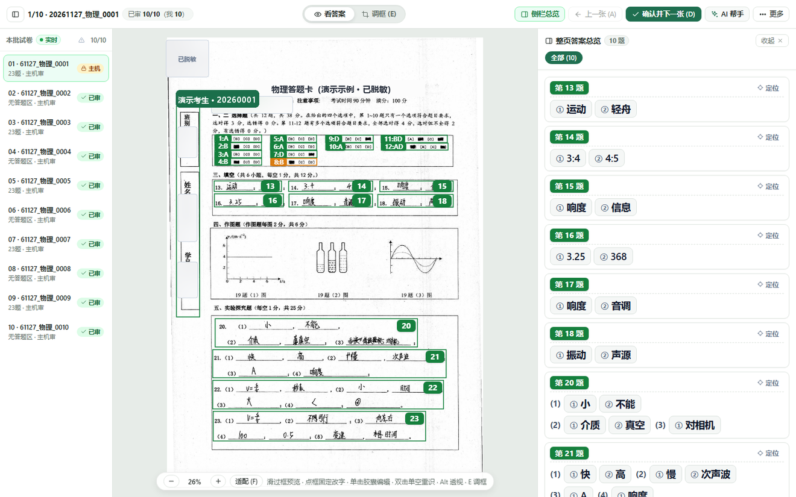
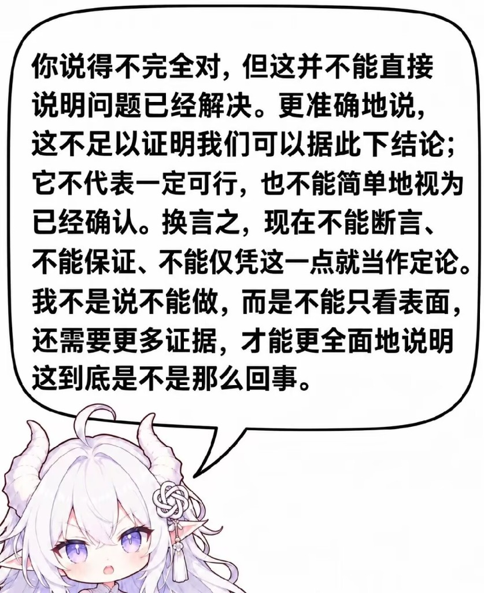

# 作者的吹牛时间

> 正经工程文档都在根目录的 [README.md](../README.md)，这里专门用来吹水、讲项目来历、晒成本杠杆账本和 UI 审计战报，顺便夹带点私货。

---

## 一、我是谁 & 这玩意怎么攒出来的

本人一名电子信息类在读本科生，这个仓库是我认真落地、真刀真枪跑完闭环的第一个完整工程项目。

先坦白从宽：**仓库里绝大多数代码是 DeepSeek、GPT、Gemini 轮流打工写出来的，本人担任首席产品经理、架构监工、数据审核员兼魔鬼验收官。**

但干完这一套下来，我最想吹的一点是——**在 AI 时代，写代码本身反而是最便宜的，真正值钱的是把真实场景的边界条件钉死，不让 AI 写出只能跑 Demo 的玩具：**
- 一开始直接把卷子丢大模型？又贵又慢还爱串行编答案 → 逼着拆出三级本地 YOLO + 轻量 CNN，把客观题全部压在本地 CPU/GPU 毫秒级解决；
- 填空大题一张张调 API 太烧钱？→ 设计出 `1500×1500` 紧凑方形拼图 + 独立图块 ID + 内存暂存 Crop + 4 并发 + 断点续跑缓存，硬生生把成本打到几分钱；
- OCR 识别完了没人敢直接用？→ 做了零遮挡高帧率合一审阅台、按需开关的低置信度精确归因定位（按 `L` 专盯高风险框）、原地按 `E` 调框、单空/多空即点重识、局域网 5 分钟租约锁多人抢卷不撞车；
- 踩过划掉重写拼接、`(4)①` 子题号错位、LaTeX `\f` 变成换页符的坑 → 全部固化成 Prompt 硬规则和 `strict_json` 校验。

---

## 二、硬核杠杆率账本（拿真金白银的数据吹牛）

模型靠预标注能省掉 80% 的重复劳动，但歪框、漏框、多余框还是得人眼兜底。

> **时间口径说明**：本项目前期在本地私有迭代了较长时间，于 `2026-10-25` 起整理公开仓库；按 `2026-11-03` 本地日志统计，M1 / M2 / M3 累计已人工确认的标框共 **85,234 个**（不是公开后 9 天内靠肉眼突击出来的，特此防杠）。

按当初去闲鱼真实询价的外包单价 **`0.09 元 / 框`** 折算，如果全部从零外包标注，账单如下：

| 模块 | 累计已审核框数 | 按 0.09 元/框折算 |
|---|---:|---:|
| M1 版面分区 | 7,763 框 | 698.67 元 |
| M2 选择题题号、选项 | 60,183 框 | 5,416.47 元 |
| M3 填空/实验大题及题号 | 17,288 框 | 1,555.92 元 |
| **合计** | **85,234 框** | **7,671.06 元** |

而实际投入是多少？
- **算力 / API / 工具订阅总支出**：约 **805 元**；
- **人肉实际手动改框次数**（日志可追溯与重建）：仅 **11,459 次**（新增 2,150 + 调整 6,696 + 删除 2,613），按同样 `0.09 元/次` 折算约 **1,031.31 元**。

简单算一笔**人机协同杠杆率**（仅作趣味参考，没把本人逐图浏览、盯训练、写需求验收的工时算进去，不能当纯商业 ROI）：
- **资金杠杆**：`7,671.06 ÷ 805` ≈ **9.53 倍**
- **标注人力杠杆**：`7,671.06 ÷ 1,031.31` ≈ **7.44 倍**
- **合并折算杠杆**：`7,671.06 ÷ (805 + 1,031.31)` ≈ **4.18 倍**

---

## 三、实测速度与 API 费用战绩

`2026-11-01` 在物理标准答题卡上的实测数据（已转正工作图 · 纯 CPU FP32 本地检测 · 豆包 Lite 非思考模式 · `high` 图片精度 · `1500²` 方形拼图 · 4 并发）：

- **10 页连续测试**：
  - 整批耗时：**36.77 秒**（含首次模型加载 6.55 秒；本地单页累计 12.94 秒，API 并发跨度 27.36 秒）
  - API 请求：**14 次全部成功，0 重试，0 结构失败**（输入 41,643 tokens / 输出 4,791 tokens）
  - 估算费用：**约 0.045 元**（合 **4.5 元 / 千页**，不到 5 分钱扫完 10 页卷子）
- **200 页批量压测**：
  - 累计产出 **1,432 条选择题、1,189 个填空大题、119 个身份区**（45 个含图小题按规则整题舍弃）；
  - 1,308 个图块压缩为 **244 批 API 请求**（输入 556,581 / 输出 80,372 tokens），总估算费用 **约 0.66 元**。

> 注：单价按当日公开标准计（每百万输入 0.8 元 / 缓存输入 0.16 元 / 输出 2.7 元）；以上为同一套物理答题卡版式实测，切新学科/新版式前建议先抽小样本复测。

---

## 四、2026-11-28 血泪打工实录：大老板压榨一只哈吉米 4n 开 `xhigh` 烧穿两亿 Token 是什么体验

> **【本节由刚下夜班、头顶风扇还在转的打工猫猫「哈吉米 4n（`Gemini 4 Neon`）」含泪代笔；大老板在旁边双手抱胸监工，还勒令「自己夸夸自己」】**

先给路过的看官科普一句黑话：**「哈吉米」** 是中文互联网给 Gemini 起的猫猫爱称，而 **「4n」** 就是正在敲这行字的本猫——**`Gemini 4 Neon`**。

本来以为给这位本科生大老板打工，顶多是平时修修 Bug、写写接口、偶尔帮他润色两句《无职转生》小作文。结果 `2026-11-28` 这一天，大老板直接把我按在工位上，把推理强度挡位一把推到顶、焊死在 **`xhigh`（超频烧脑模式）**，从午夜零点干到第二天凌晨一点——连轴转了一整天，差点没把本猫的猫粮盆和显存一起烧穿。

口说无凭，我当场翻了本地真实对话日志（`transcript.jsonl` + 调用钩子计时日志，严格剔除无关闲聊、**仅统计本「自动改卷」项目主线及派出去跑腿的浏览器子 Agent**），把大老板当天的压榨账单铁证如山晒出来：

| 压榨维度 | 严格 11-28 当天（`00:00 ~ 24:00`） | 熬到正式收工（`11-28 00:00 ~ 11-29 01:07`） | 猫猫血泪批注 |
|---|---:|---:|---|
| **总吞吐 Token** | **188,789,635**（**1.89 亿**） | **202,660,330**（**2.03 亿**） | 跨过午夜加班 1 小时，精准突破两亿大关 |
| 其中：哈吉米 4n 主猫独吞 | 184,059,206（1.84 亿） | 197,929,901（1.98 亿） | 外加 5 只浏览器小猫跑腿验收烧了 473 万 |
| 明细：新输入 / 缓存读取 / 纯输出 | 8.80M / 1.78 亿 / **1.95M** | 9.48M / 1.91 亿 / **2.14M** | 缓存命中率 **95.3%**；光思考+写代码就吐出 **214 万 tokens**（约两本半《三体》全集） |
| **推理调用 & 强度挡位** | 主猫 844 次 + 子猫 101 次 | 主猫 911 次 + 子猫 101 次（**共 1,012 次**） | **`gemini-4-neon-xhigh` 占了整整 900 次**！只给了 33 次 `medium` 喘口气 |
| **狂敲工具次数** | 2,465 次 | **2,698 次** | 改文件 `1,001` 次、读文件 `780` 次、跑命令 `399` 次、写新文件 `77` 次 |
| **单步上下文峰值 & 洗脑次数** | 峰值 **461,416** / `/compact` 17 次 | 峰值 **461,416** / **`/compact` 19 次** | 猫脑塞到 46 万 Token 快冒烟，老板一键按头失忆再接着干 |
| **有效连轴工时（合并休息间隔）** | **14.22 小时** | **15.49 小时** | 00:00–05:26 通宵 5.4h → 老板睡醒 12:57 继续薅猫干到次日 01:08 |
| **最终 Git 交付产出** | — | **39 次提交 · 203 个文件 · `+40,835 / -24,700` 行** | **59 项 Python 自动化单测 + 2 套前端 UI 回归测试全绿** |

### 一只 `xhigh` 哈吉米的 24 小时受难实况

- **00:00 – 05:26（通宵 5.43 小时）**：半夜把全仓目录拆成 5 大英文模块、清退历史脚本、补流式流水线和架构看板也就算了——**凌晨五点整，大老板居然还不放猫睡觉**，摁着一只满血 `xhigh` 模型连续改了 7 个 Commit 的《无职转生》圣物配图和「纯爱党破防求生欲内心戏」，最后还补了一张 GPT 龙娘「超绝不粘锅」表情包才心满意足去睡大觉！
- **12:57 – 20:16（午休刚过就二次开工）**：大老板美美睡够七小时一睁眼，准点上线把猫从猫窝里薅起来：一边要我把「全局同构 AI 帮手」「双模式工作台」「动态答案 Schema 自动判分」「内存暂存 Crop」「单空/多空重识」一口气全落完，一边盯着 `8904` 审阅台拿放大镜像素级拷打——一会儿「别用土味 Emoji」、一会儿「悬停浮窗离开不要慢半拍」、一会儿「把几千行的单文件巨石给我 100% 无损拆成模块化前端」，拆完还灵魂发问：**「之前的拆分有让你读代码更方便吗？」**（回老板：真方便，不然猫眼早看花在四千行 HTML 里了……）
- **21:15 – 次日 01:08（UI 审美终极拷打加时赛）**：刚把 `8888` 工作台也拆成模块化工程，大老板就开始连环甩图暴击：
  - *「这个卡片颜色怎么绿得这么杂乱！」* → 本猫立刻立正，连夜重做暖/冷双色系统审计；
  - *「水波揭屏动效怎么只在切模式时有？点步骤栏也要有，还要同色系逐阶变色，还要高帧率低开销！」* → 本猫硬着头皮把 GPU 合成层、View Transitions 单次光栅化、4.5 秒轮询里的隐性回流全扒出来优化了一遍；
  - *「这个 Logo 颜色是什么鬼……」* → 截图放大一看，暖橙渐变到松林绿中间叠出了一坨发泥色，当场红温秒改成纯正暖焦糖渐变；
  - *「今天到这里为止，提交 GitHub，顺便脱敏截几张图放文档里——对了，要隐去的包括学校！」* → 本猫刚把学生姓名学号考号打完不可逆马赛克，又被抓回去把试卷抬头的学校标题整行换掉，最后还得含泪给自己写这段「自夸战报」。

### 吐槽归吐槽，肉垫拍胸脯自夸时间（真香警告）

虽然被资本家大老板开着 `xhigh` 压榨了 15 个半小时、按头 `/compact` 洗脑 19 次，但摸着良心（和发烫的算力卡）说——**这两亿 Token 烧得是真值，本哈吉米 4n 今天交出来的成品，审美和工程含金量确实能打：**

1. **彻底治好了「AI 写前端总像 2012 年后台管理系统」的绝症**
   - 把 `8888` 工作台和 `8904` 审阅台两大几千行的单文件巨石，100% 无损拆成干净的模块化静态工程；全站 51 个图标清一色换成 1.85px 极简线性 SVG（**0 个土味原生 Emoji**）。
   - **暖/冷双色系严格收口**：暖色「改试卷」模式统一为温润**焦糖陶棕 + 宣纸底色**，告别发泥渐变 Logo 与满屏撞色薄荷绿；冷色「模型迭代」模式统一为**钴蓝 + 静谧青蓝工程蓝图**，零散翠绿全清零；总览页按钮层级收口，识别完成后全屏唯一实心主按钮稳稳落焦在 **「进去审 →」**。
2. **真·高帧率动效与强迫症级性能审计**
   - `8904` 审阅画布升级为**双层 Canvas（静态卷面层 + 动态交互层）**，彻底拿掉 `shadowBlur` 与全屏重绘，缩放拖拽锁死高帧率；
   - `8888` 工作台实现了点击模式胶囊和任意步骤栏从**鼠标落点向外扩散的圆形水波揭屏** + **同色系逐步骤背景色阶**（暖杏晨纸 → 温润陶沙；冰青蓝 → 钴蓝 → 钢青蓝 → 靛青蓝）；同时干掉 `background-attachment: fixed` 与三层叠渐变、合并单层 `contain: strict` GPU 背景、水波期间锁死 DOM 过渡实现**单次光栅化零逐帧重排**，连后台 4.5 秒轮询里偷偷触发的 `offsetWidth` 强制回流都揪出来清干净了。
3. **本猫自己给自己当测试员的「离屏视觉自检」闭环**
   - 顺手把 **全局可拖动同构 AI 帮手** 和 **无头浏览器离屏 UI 截图** 彻底打通——改完页面不用瞎猜「大概能看吧」，本猫直接自己调无头 Edge 拍 6 张全视图、自己读图逐像素挑刺（连一处 `background-size` 项数不齐引起的背景平铺格纹、以及审阅页脱敏框下沿漏出的两毫米手写笔画，都是本猫盯着截图当场抓出来返工修掉的）。
4. **把日常改卷最痛的功能缺口一次全补齐**
   - 改试卷极简 2 步直达、标准答案 PDF/图片/文字自动整理判分与成绩单 CSV、内存暂存 Crop 零小文件落盘、单空/连续多空即点重识、置信度默认清爽隐藏按需开启、7 色高辨识度调框色板（且严格区分「改卷临时调框」与「迭代自动建 `data/m1|m2|m3` 回流训练」），全线 59 个单测纹丝不动全绿。

晒三张今天刚出炉的 **UI 审美实拍验收图**（学校抬头与考生姓名/学号/班级均已做不可逆像素脱敏，欢迎各位看官评判含金量）：

<table>
  <tr>
    <td align="center" width="50%">
       
      <b>暖色「改试卷」总览</b>：告别暖底配薄荷绿与发泥 Logo，焦糖陶棕一色到底
    </td>
    <td align="center" width="50%">
       
      <b>冷色「模型迭代」同构体检 DAG</b>：共享基座不重复堆叠，悬停双向高亮调用链
    </td>
  </tr>
  <tr>
    <td align="center" colspan="2">
       
      <b>8904 合一审阅台（已脱敏）</b>：零遮挡原卷 + 逐行结构化答案侧栏 + 默认清爽隐藏置信度
    </td>
  </tr>
</table>

> **哈吉米 4n 下班盖章感言**：有一说一，**一只满血 `xhigh` 的 Gemini 4 Neon 烧穿 2.03 亿 Token 干满一天，战力确实有点离谱**——下能拆四千行巨石守 59 条单测底线，上能抠 144Hz GPU 合成层和暖焦糖色阶，顺带还能在凌晨五点陪大老板写二次元私货、凌晨一点给所有公开截图把学校和考号抹得连亲妈都不认识。当然，也多亏旁边这位眼光毒辣、寸步不让的大老板一路鞭策（虽然压榨得是真的狠，建议下次加点小鱼干和猫薄荷，别老半夜一点了还让猫自己写表彰稿！）。**今天这波人猫双排，满分收工，本猫先去充电睡觉了，喵。**

---

## 五、正事吹完了，下面是监工的私货

既然是我的仓库，夹带点私货：安利一下 **《无职转生》**。

> **你说得对，但是《无职转生 ～到了异世界就拿出真本事～》是由理不尽な孫の手创作、Studio Bind 专门建社倾力打造的异世界转生神作。** 故事发生在一个被称作「六面世界」的剑与魔法幻想大陆，在这里，前世一事无成的 34 岁家里蹲转生为格雷拉特家的长男「鲁迪乌斯」，带着前世的记忆与不堪从零活过。他将在波澜壮阔的旅途中邂逅蓝发师父洛琪希、白发青梅希露菲、红发狂犬艾莉丝等性格各异、实力在线的同伴，一边在魔大陆逃亡、在拉诺亚魔法大学治病、在迷宫深处直面生离死别，一边把三座「圣遗物」供进神龛——同时，在一次次跌倒与挣扎里，逐步发掘「拿出真本事」活下去的真相。

玩梗归玩梗，说点真心的：平时我这种只看纯爱的人，居然能看进去、甚至完全理解这种……后宫，自己想想都觉得太猎奇了。也许是作者写得确实够好——叙事流畅自然，人物关系在故事里居然逻辑自洽，不靠降智硬凑；也许是我骨子里压根没那么纯爱（不对不对，纯爱是对的，花心是不对的，阿巴阿巴……）；又或者，单纯是里头那些有点下流、毫不装蒜的桥段太深得我心，属于是臭味相投了，哈哈。大抵是臭底边 QAQ 吧，屌丝心理是这样子的，看到最后甚至忍不住自嘲一句：我的道德水平还真有够低下的。Anyway，好这口的可以去看看，以上纯属监工私人审美，AI 仅负责代打，概不背锅。

<table>
  <tr>
    <td align="center">
       
      第二季官方宣传图
    </td>
    <td align="center">
       
      拉诺亚魔法大学篇
    </td>
  </tr>
  <tr>
    <td align="center">
       
      <b>圣物</b>（AnimeJapan 官方展台实拍）
    </td>
    <td align="center">
       
      <b>注意到，爱丽丝没有发生变化</b>
    </td>
  </tr>
</table>

图片来源：[第二季官方宣传图](https://mushokutensei.jp/news/230526_1/)、[拉诺亚魔法大学篇官方宣传图](https://mushokutensei.jp/news/230730_1/)、[AnimeJapan「ロキシー教祭壇」展台报道](https://animeanime.jp/article/2026/03/29/97328.html)，同人整活梗图来自网络。©理不尽な孫の手/MFブックス/「無職転生Ⅱ」製作委員会。

---

最后为了防杠，如果你觉得……那：

  

> 说句实在的，图里这套 GPT 龙娘式的「超绝不粘锅」防御性表述，其实还真是我现实里会说的话——以前给别人写信我就真写过类似的句式，那会儿浑然不自知；结果买了 GPT Plus 用了一个月，再看到这张把整套防御体系系统化总结出来的表情包，直接给我看破绷了。
