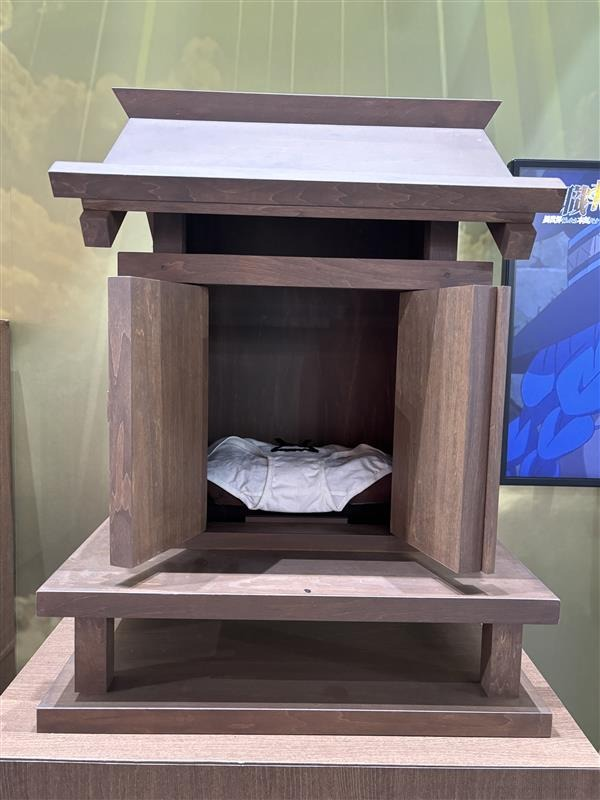

# 作者的吹牛时间

> 正经工程文档都在根目录的 [README.md](../README.md)，这里专门用来吹水、讲项目来历、晒成本杠杆账本，顺便夹带点私货。

---

## 一、我是谁 & 这玩意怎么攒出来的

本人一名电子信息类在读本科生，这个仓库是我认真落地、真刀真枪跑完闭环的第一个完整工程项目。

先坦白从宽：**仓库里绝大多数代码是 DeepSeek、GPT、Gemini 轮流打工写出来的，本人担任首席产品经理、架构监工、数据审核员兼魔鬼验收官。**

但干完这一套下来，我最想吹的一点是——**在 AI 时代，写代码本身反而是最便宜的，真正值钱的是把真实场景的边界条件钉死，不让 AI 写出只能跑 Demo 的玩具：**
- 一开始直接把卷子丢大模型？又贵又慢还爱串行编答案 → 逼着拆出三级本地 YOLO + 轻量 CNN，把客观题全部压在本地 CPU 毫秒级解决；
- 填空大题一张张调 API 太烧钱？→ 设计出 `1500×1500` 紧凑方形拼图 + 独立图块 ID + 4 并发 + 断点续跑缓存，硬生生把成本打到几分钱；
- OCR 识别完了没人敢直接用？→ 做了零遮挡合一审阅台、低置信度精确归因定位（按 `L` 专盯高风险框）、原地按 `E` 调框、局域网 5 分钟租约锁多人抢卷不撞车；
- 踩过划掉重写拼接、`(4)①` 子题号错位、LaTeX `\f` 变成换页符的坑 → 全部固化成 Prompt 硬规则和 `strict_json` 校验。

---

## 二、硬核杠杆率账本（拿真金白银的数据吹牛）

模型靠预标注能省掉 80% 的重复劳动，但歪框、漏框、多余框还是得人眼兜底。

> **时间口径说明**：本项目前期在本地私有迭代了较长时间，于 `2026-10-25` 起整理公开仓库；按 `2026-11-03` 本地日志统计，M1 / M2 / M3 累计已人工确认的标框共 **85,234 个**（不是公开后 9 天内靠肉眼突击出来的，特此防杠）。

按当初去闲鱼真实询价的外包单价 **`0.09 元 / 框`** 折算，如果全部从零外包标注，账单如下：

| 模块 | 累计已审核框数 | 按 0.09 元/框折算 |
|---|---:|---:|
| M1 版面分区 | 7,763 框 | 698.67 元 |
| M2 选择题题号、选项 | 60,183 框 | 5,416.47 元 |
| M3 填空/实验大题及题号 | 17,288 框 | 1,555.92 元 |
| **合计** | **85,234 框** | **7,671.06 元** |

而实际投入是多少？
- **算力 / API / 工具订阅总支出**：约 **805 元**；
- **人肉实际手动改框次数**（日志可追溯与重建）：仅 **11,459 次**（新增 2,150 + 调整 6,696 + 删除 2,613），按同样 `0.09 元/次` 折算约 **1,031.31 元**。

简单算一笔**人机协同杠杆率**（仅作趣味参考，没把本人逐图浏览、盯训练、写需求验收的工时算进去，不能当纯商业 ROI）：
- **资金杠杆**：`7,671.06 ÷ 805` ≈ **9.53 倍**
- **标注人力杠杆**：`7,671.06 ÷ 1,031.31` ≈ **7.44 倍**
- **合并折算杠杆**：`7,671.06 ÷ (805 + 1,031.31)` ≈ **4.18 倍**

---

## 三、实测速度与 API 费用战绩

`2026-11-01` 在高中物理标准答题卡上的实测数据（已转正工作图 · 纯 CPU FP32 本地检测 · 豆包 Lite 非思考模式 · `high` 图片精度 · `1500²` 方形拼图 · 4 并发）：

- **10 页连续测试**：
  - 整批耗时：**36.77 秒**（含首次模型加载 6.55 秒；本地单页累计 12.94 秒，API 并发跨度 27.36 秒）
  - API 请求：**14 次全部成功，0 重试，0 结构失败**（输入 41,643 tokens / 输出 4,791 tokens）
  - 估算费用：**约 0.045 元**（合 **4.5 元 / 千页**，不到 5 分钱扫完 10 页卷子）
- **200 页批量压测**：
  - 累计产出 **1,432 条选择题、1,189 个填空大题、119 个身份区**（45 个含图小题按规则整题舍弃）；
  - 1,308 个图块压缩为 **244 批 API 请求**（输入 556,581 / 输出 80,372 tokens），总估算费用 **约 0.66 元**。

> 注：单价按当日公开标准计（每百万输入 0.8 元 / 缓存输入 0.16 元 / 输出 2.7 元）；以上为同一套物理答题卡版式实测，切新学科/新版式前建议先抽小样本复测。

---

## 四、正事吹完了，下面是监工的私货

既然是我的仓库，夹带点私货：安利一下 **《无职转生》**。

> **你说得对，但是《无职转生 ～到了异世界就拿出真本事～》是由理不尽な孫の手创作、Studio Bind 专门建社倾力打造的异世界转生神作。** 故事发生在一个被称作「六面世界」的剑与魔法幻想大陆，在这里，前世一事无成的 34 岁家里蹲转生为格雷拉特家的长男「鲁迪乌斯」，带着前世的记忆与不堪从零活过。他将在波澜壮阔的旅途中邂逅蓝发师父洛琪希、白发青梅希露菲、红发狂犬艾莉丝等性格各异、实力在线的同伴，一边在魔大陆逃亡、在拉诺亚魔法大学治病、在迷宫深处直面生离死别，一边把三座「圣遗物」供进神龛——同时，在一次次跌倒与挣扎里，逐步发掘「拿出真本事」活下去的真相。

玩梗归玩梗，说点真心的：平时我这种只看纯爱的人，居然能看进去、甚至完全理解这种……后宫，自己想想都觉得太猎奇了。也许是作者写得确实够好——叙事流畅自然，人物关系在故事里居然逻辑自洽，不靠降智硬凑；也许是我骨子里压根没那么纯爱（不对不对，纯爱是对的，花心是不对的，阿巴阿巴……）；又或者，单纯是里头那些有点下流、毫不装蒜的桥段太深得我心，属于是臭味相投了，哈哈。大抵是臭底边 QAQ 吧，屌丝心理是这样子的，看到最后甚至忍不住自嘲一句：我的道德水平还真有够低下的。Anyway，好这口的可以去看看，以上纯属监工私人审美，AI 仅负责代打，概不背锅。

<table>
  <tr>
    <td align="center">
       
      第二季官方宣传图
    </td>
    <td align="center">
       
      拉诺亚魔法大学篇
    </td>
  </tr>
  <tr>
    <td align="center">
       
      <b>圣物</b>（AnimeJapan 官方展台实拍）
    </td>
    <td align="center">
       
      <b>注意到，爱丽丝没有发生变化</b>
    </td>
  </tr>
</table>

图片来源：[第二季官方宣传图](https://mushokutensei.jp/news/230526_1/)、[拉诺亚魔法大学篇官方宣传图](https://mushokutensei.jp/news/230730_1/)、[AnimeJapan「ロキシー教祭壇」展台报道](https://animeanime.jp/article/2026/03/29/97328.html)，同人整活梗图来自网络。©理不尽な孫の手/MFブックス/「無職転生Ⅱ」製作委員会。

---

最后为了防杠，如果你觉得……那：

  

> 说句实在的，图里这套 GPT 龙娘式的「超绝不粘锅」防御性表述，其实还真是我现实里会说的话——以前给别人写信我就真写过类似的句式，只不过这张表情包帮我把这套体系系统化地说出来了，属实是说到心坎里了。
